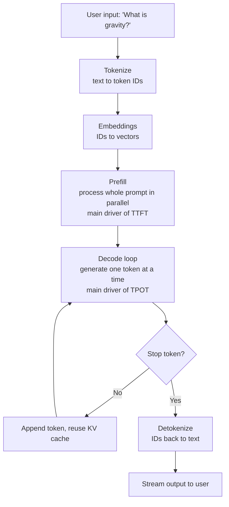

<InsightSummary>
When you send a prompt, the model doesn't see words — it sees integers. It processes your whole prompt once (prefill), then generates the answer one token at a time (decode), reusing a cache so it doesn't recompute everything. Two numbers describe the experience: how long until the first token appears, and how fast the rest stream out.
</InsightSummary>

<Body>
## The mental model

Text enters as words, but the model works with token IDs and vectors. Hold that one sentence and most of inference makes sense. Below is the full path from "What is gravity?" to a streamed answer.

## Step 1: Tokenization — text becomes integers

The model can't read characters. A tokenizer splits your text into **tokens** — subword pieces — and maps each to an integer ID from a fixed vocabulary. "What is gravity?" might become tokens like `What`, `is`, `grav`, `ity`, `?` and then IDs like `[2601, 318, 26110, 879, 30]`.

This is why **tokens are not words.** Common words stay whole; rare words get split into pieces. The dominant method is **BPE (Byte-Pair Encoding)**, which builds the vocabulary by repeatedly merging the most frequent character pairs. The practical consequence: token count — not word count — is what drives your cost, your speed, and how much fits in the context window.

## Step 2: Embeddings and attention

Each token ID is looked up in an embedding matrix and turned into a vector — a list of floating-point numbers (often thousands of dimensions). Now "meaning" is numbers the model can do math on.

Inside each transformer layer, the key operation is **self-attention**: every token computes how much it should "pay attention" to every other token, using three projections (query, key, value). This is what lets the model weigh context — to know that "it" refers to "gravity," or that the question expects a definition. Stack many of these layers and you have the transformer.

## Step 3: Prefill vs decode — why generation is slow

Inference happens in two distinct phases, and understanding the split explains almost everything about LLM latency.

- **Prefill** processes your entire prompt *in parallel, in one pass.* All prompt tokens go through the network together. This phase is **compute-bound** — it's doing a lot of math at once but only once.
- **Decode** generates the answer **one token at a time.** The model predicts the next token, appends it to the sequence, and feeds the result back in to predict the token after that — repeating until it emits a stop token. This phase is **memory-bound** and inherently sequential: token N+1 cannot be computed until token N exists.

That sequential decode loop is *why text generation feels slow and streams out word by word.* Prefill is one big step; decode is many small ones.

## Step 4: The KV cache

During decode, naively re-running attention over the whole sequence for every new token would be hugely wasteful. The **KV cache** fixes this: it stores the key and value vectors already computed for previous tokens, so each new token only computes attention against the cache instead of recomputing the entire history.

The catch: the KV cache **grows linearly with sequence length**, so it becomes the main memory bottleneck for long contexts. This is why very long prompts pressure GPU memory and why "long context" is expensive.

## Step 5: TTFT vs TPOT — the two latency metrics

Two numbers describe how an LLM feels to use, and they map cleanly onto the two phases:

- **TTFT (Time To First Token)** — how long from sending the prompt to seeing the first token. This is dominated by **prefill**. Long prompts and cold caches make TTFT worse.
- **TPOT (Time Per Output Token)** — how fast each subsequent token streams out. This is dominated by the **decode** loop and KV-cache pressure.

The simple rule: **prefill affects TTFT; decode affects every token after that (TPOT); the KV cache affects memory.** If users complain "it takes forever to start," look at prefill and prompt length. If they complain "it's slow to finish," look at decode throughput.

## Step 6: Sampling — where randomness enters

The model's final layer (the LM head) produces a score for every token in the vocabulary; a softmax turns those into a probability distribution. *How you pick from that distribution* is sampling:

- **Greedy** — always take the single highest-probability token. Deterministic, but often dull and repetitive.
- **Temperature** — scales the distribution. Low temperature (→ 0) makes it sharp and deterministic; high temperature (→ 1+) flattens it for more creative, varied output.
- **Top-p (nucleus)** — sample only from the smallest set of tokens whose probabilities sum to p, cutting off the unlikely tail.

This is why the same prompt can give different answers: with temperature and top-p, generation is a controlled roll of weighted dice, not a fixed lookup.

## Step 7: Detokenize and stream

Finally, the generated token IDs are mapped back to text and streamed to you one piece at a time — which is exactly what you see when an answer types itself out on screen.

## The full pipeline at a glance

<Diagram>

</Diagram>

That's the whole story: words in, integers and vectors in the middle, one heavy parallel pass to read the prompt, then a patient one-token-at-a-time loop to write the answer — with a cache holding it all together.
</Body>

<KeyTakeaways>
- The model works on token IDs and vectors, not words; token count (via BPE) drives cost, speed, and context limits.
- Inference has two phases: prefill reads the whole prompt in one parallel pass; decode generates one token at a time, which is why generation is slow.
- The KV cache avoids recomputation but grows with sequence length, making it the main memory bottleneck for long contexts.
- TTFT (time to first token) is set by prefill; TPOT (time per output token) is set by the decode loop.
- Sampling (greedy, temperature, top-p) is where randomness enters — the reason the same prompt can produce different answers.
</KeyTakeaways>

<WhatToDoNext>
- Go deeper on tokens and limits with [Tokenization and context windows](/ai-engineering/tokenization-and-context-windows).
- Connect generation to reliability with [Understanding hallucinations](/ai-engineering/understanding-hallucinations).
- Follow the [AI Engineer technical path](/roadmap/ai-engineer-technical-path).
</WhatToDoNext>

<SourceNote />
