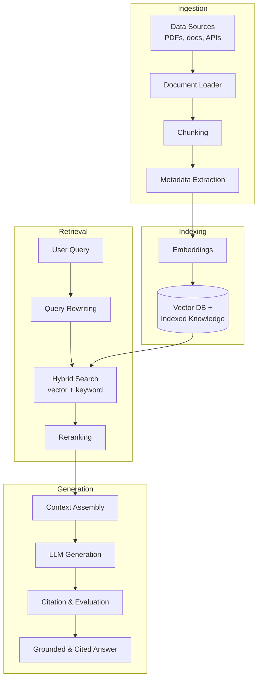

<InsightSummary>
"RAG" is not one architecture — it is a family. They range from a four-line retrieve-and-generate pipeline to graph-enhanced and self-correcting agentic systems. The skill is matching the architecture to the query, the latency budget, and the cost ceiling, not reaching for the fanciest option by default.
</InsightSummary>

<Body>
## What RAG is, in one paragraph

Retrieval-Augmented Generation means: before the LLM answers, you fetch relevant information from your own data and add it to the prompt. The model then generates an answer grounded in those retrieved facts instead of relying only on what it memorized during training. That single idea fixes the LLM's two biggest weaknesses — it doesn't know your private data, and its knowledge is frozen at the training cutoff. Everything below is a variation on *how* you retrieve and *how much reasoning* you wrap around the retrieval.

## The spectrum

Think of RAG architectures as rungs on a ladder. Each rung adds capability, cost, and latency. Climb only as high as your problem actually requires.

### 1. Naive / standard RAG
The baseline: embed the query, search a vector index, take the top-k chunks, paste them into the prompt, generate. Single-hop, one shot, no reordering.
- **Adds:** grounding in your data with almost no machinery.
- **Choose when:** straightforward factual lookups where accuracy matters but query complexity is low — FAQ bots, policy lookups, knowledge-base search.
- **Tradeoff:** cheapest and fastest, but fragile. Retrieval quality is whatever your embedding model gives you, and one bad chunk poisons the answer.

### 2. Reranked RAG
Retrieve a generous candidate set (say top-50), then run a stronger relevance model (a cross-encoder reranker) to reorder them and keep the best handful before generation.
- **Adds:** much higher precision — the chunks the LLM sees are genuinely the most relevant, not just the nearest neighbors in vector space.
- **Choose when:** vector search returns "kind of related" results and answer quality suffers from noise.
- **Tradeoff:** one extra model call per query. Modest added latency, large quality gain. This is the single highest-leverage upgrade over naive RAG.

### 3. Hybrid RAG
Run semantic (vector) search and lexical (keyword / BM25) search in parallel, then merge and rank the combined results.
- **Adds:** robustness. Vector search is great at meaning; keyword search is great at exact terms, product codes, names, and acronyms. Together they cover each other's blind spots.
- **Choose when:** your corpus has lots of exact-match terms (SKUs, error codes, legal citations) that pure embeddings miss.
- **Tradeoff:** two retrieval paths and a merge step. Slightly more infrastructure, more reliable recall.

### 4. Graph RAG
Extract entities and relationships from your documents into a knowledge graph. At query time, pull connected context across linked records instead of isolated chunks.
- **Adds:** multi-hop, relational reasoning. It can answer "how is A connected to C through B?" — questions where the answer lives in the *relationships*, not in any single passage.
- **Choose when:** entity-rich, multi-source domains — research over linked concepts, fraud networks, org structures, biomedical knowledge.
- **Tradeoff:** building and maintaining the graph is real engineering work. Highest setup cost on this list; pays off only when relationships carry the meaning.

### 5. Agentic RAG
A reasoning agent sits in front of retrieval and decides what to do: which sources to query (vector DB, knowledge graph, web search, tools), in what order, and whether the result is good enough — looping and re-querying until it is.
- **Adds:** adaptivity and self-correction. It plans retrieval as a multi-step process: understand the question, decide what's needed, retrieve from multiple sources, reason, refine, respond.
- **Choose when:** complex, multi-faceted questions that no single retrieval pass can answer — deep research, dynamic data, questions needing synthesis across sources.
- **Tradeoff:** slowest and most expensive — multiple LLM calls per answer — and harder to make reliable. Overkill for simple lookups.

### 6. Self / corrective / adaptive RAG
A cluster of refinements that make retrieval conditional and self-checking:
- **Self-RAG** first asks *do I even need to retrieve?* and critiques its own retrieved context before answering.
- **Corrective RAG** validates whether retrieved context is strong and consistent; if not, it re-retrieves (or falls back to web search) instead of answering on weak evidence.
- **Adaptive RAG** routes by query complexity — simple questions get a cheap, fast single retrieval; complex ones get deep multi-source retrieval.
- **Adds:** quality gates and cost control. You stop paying for retrieval you don't need and stop answering from context you shouldn't trust.
- **Choose when:** mixed query workloads where some questions are trivial and others are hard, and where answering on bad context is costly.
- **Tradeoff:** added control logic and extra model calls on the hard path, offset by savings on the easy path.

### How to climb the ladder
Start at naive RAG. Add reranking the moment answer quality lags. Add hybrid search if exact terms get missed. Reach for graph, agentic, or self/corrective variants only when the question type genuinely demands relational reasoning, multi-source synthesis, or per-query routing. Most production systems live happily at "reranked + hybrid."

## A production RAG pipeline

<Diagram>

</Diagram>

Notice that RAG quality is largely decided *before* the LLM ever sees the prompt. Poor chunking, missing metadata, weak query rewriting, and no reranking are the most common failure points. The optimization levers are the same four knobs in reverse: better chunking, metadata filters, hybrid search, and a strong reranker — plus context compression so you send the model the best context, not the most.

## The five pillars of advanced RAG

When you outgrow "a pipeline" and start building a system, five concerns dominate. A useful reframe: stop thinking of RAG as a linear pipeline and start thinking of it as a **knowledge architecture**.

1. **Knowledge mapping.** Catalog every source — docs, databases, internal chat, tribal knowledge — so you know what you're retrieving from and what's missing.
2. **Multi-modal representation.** Real knowledge isn't only chunks of text. Combine vector embeddings, knowledge graphs, SQL, and ontologies so each kind of question hits the right representation.
3. **Retrieval orchestration.** Route intelligently: decide *what* to query and *when to skip* retrieval entirely. This is the agentic-routing pillar.
4. **Knowledge freshness.** Documents go stale. You need versioning, staleness detection, and re-indexing pipelines so the index reflects current reality.
5. **Observability and evaluation.** Measure accuracy, relevance, faithfulness, latency, and cost continuously. You cannot improve retrieval you cannot see.

The slogan to remember: **RAG is the pattern; knowledge architecture is the strategy.** A linear "documents → chunks → vectors → prompt → response" pipeline is simple but fragile and static. A systemic design with mapping, multi-modal storage, orchestration, freshness, and observability is what holds up in production.
</Body>

<KeyTakeaways>
- RAG is a family of architectures, not one design — naive, reranked, hybrid, graph, agentic, and self/corrective/adaptive each add capability at the cost of latency and money.
- Reranking is the highest-leverage single upgrade over naive RAG; hybrid search is the fix when exact terms get missed.
- Graph and agentic RAG are powerful but expensive — use them only when relationships or multi-source synthesis genuinely drive the answer.
- Retrieval quality is mostly decided before the LLM runs: chunking, metadata, query rewriting, and reranking are the real levers.
- At scale, treat RAG as a knowledge architecture governed by five pillars: mapping, multi-modal representation, orchestration, freshness, and observability.
</KeyTakeaways>

<WhatToDoNext>
- Solidify the basics with [What is RAG](/ai-engineering/what-is-rag) and then [Build a RAG pipeline](/ai-engineering/build-a-rag-pipeline).
- Add the two highest-leverage upgrades: [Hybrid search (BM25 + vector)](/ai-engineering/hybrid-search-bm25-vector) and [Reranking with cross-encoders](/ai-engineering/reranking-with-cross-encoders).
- Follow the [AI Engineer technical path](/roadmap/ai-engineer-technical-path) to see where these fit in a full curriculum.
</WhatToDoNext>

<SourceNote />
