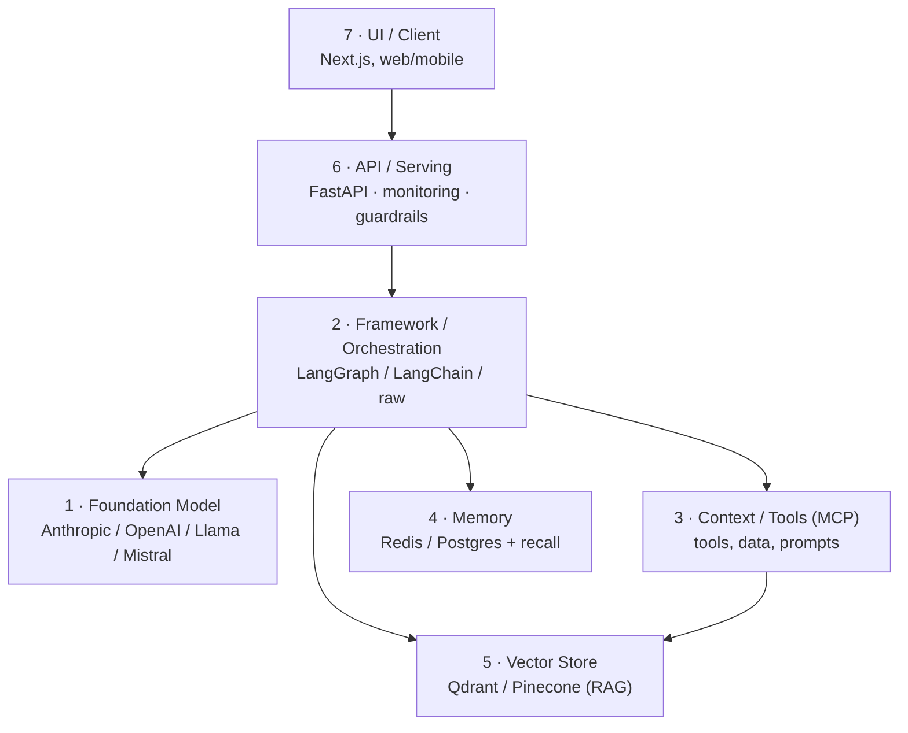

<InsightSummary>
A modern AI application is not one thing — it is a stack of layers, each with a clear job. From the bottom: a foundation model does the reasoning, a framework orchestrates the flow, a context/tool layer connects the model to the outside world, memory gives it continuity, a vector store powers retrieval, an API serves it, and a UI delivers it. You do not need to master every layer at once, and you can build the whole thing on free tiers. What matters is knowing what each layer does so you can choose deliberately and deploy in the right order.
</InsightSummary>

<Body>
## Why think in layers

When people say "I built an AI app," they rarely mean a single program. They mean an assembly of components that each handle one concern: generating text, deciding what to do, fetching knowledge, remembering, storing vectors, serving requests, and rendering a UI. Seeing the stack as layers makes the system tractable — you can reason about, swap, and debug one layer without rethinking the whole thing.

## The seven layers, bottom to top

**1. Foundation model.** The reasoning engine — the LLM that turns input into output. Common choices range from hosted frontier models (Anthropic, OpenAI) to open models you run yourself (Llama, Mistral, Gemma) and fast inference providers. This is the layer everything else exists to support.

**2. Framework / orchestration.** The layer that coordinates the flow: tool routing, chaining, branching, state, and recovery. Choices include LangGraph for stateful, branching workflows, LangChain for composable pipelines, or raw code with no framework for simple apps. This is where "agentic" behavior — planning, deciding, self-correcting — is wired together.

**3. Context / tools (MCP).** The layer that connects the model to the outside world: external functions the agent can call, plus the data and prompts it can pull in. MCP (the Model Context Protocol) is the emerging open standard for this — one connector for tools and data instead of a bespoke integration per system.

**4. Memory.** What the agent remembers across turns and sessions — short-term working context plus longer-term recall of facts and past events. Backed by stores like Redis or Postgres for fast state, with dedicated memory systems layered on for durable, cross-session recall.

**5. Vector store.** The retrieval backbone for RAG: embeddings of your documents, searched by similarity to ground answers in real knowledge. Common choices include Qdrant, Pinecone, and similar vector databases; some stacks also use a graph DB for relationships and a document DB for raw content.

**6. API / serving.** The backend that exposes your AI as something callable — typically a REST API. FastAPI is a popular choice for AI backends because it is fast, typed, and async-friendly. This layer also hosts monitoring, observability, and guardrails.

**7. UI / client.** What the user actually touches — a web frontend (e.g. Next.js) or another client that calls your API. This is the thinnest layer conceptually but the one that determines whether anyone uses what you built.

## A picture of the stack

<Diagram>

</Diagram>

## The "$0 stack" for students

You can build a complete AI app without paying anything by stitching together free tiers, one per layer: a free LLM inference tier for the model, Next.js on a free host for the frontend, FastAPI on a free backend host, an open-source orchestrator for the framework, a free embedding tier, a free vector-DB tier for storage, and a free observability tier for monitoring. The point is not the specific vendors — those rotate — but that *every layer of the stack has a free option*, so cost is not a barrier to building the real thing end to end.

## What to deploy first vs. optimize later

Resist the urge to assemble all seven layers before you ship anything. A sensible order:

1. **Ship the spine first:** model → minimal framework (or none) → API → simple UI. Prove the core loop works end to end.
2. **Add retrieval (vector store + RAG)** once you need grounded, knowledge-based answers.
3. **Add memory** when the app needs continuity across turns or sessions.
4. **Add tools/MCP** when the agent needs to act on the world, not just answer.
5. **Add observability and guardrails** before real users arrive — and harden them as traffic grows.

Optimize later: caching, cost routing between cheap and expensive models, reranking, and scaling. Those matter at volume, not on day one.

The discipline is the same as picking a framework: add a layer because a concrete need demands it, not because the architecture diagram has a box for it.
</Body>

<KeyTakeaways>
- A 2026 AI app is a layered stack: foundation model, framework/orchestration, context/tools (MCP), memory, vector store, API/serving, and UI/client.
- Each layer has one job — reason, orchestrate, connect, remember, retrieve, serve, render — so you can choose and debug them independently.
- Every layer has a free-tier option, so a student can build a full AI app end to end at $0.
- Ship the spine first (model → minimal framework → API → UI), then add retrieval, memory, tools, and observability as concrete needs appear.
- Optimization (caching, cost routing, reranking, scaling) is a later concern — add layers because a need demands them, not because a diagram has a box.
</KeyTakeaways>

<WhatToDoNext>
- Understand the retrieval layer with [What is RAG](/ai-engineering/what-is-rag).
- Learn the orchestration layer with [What is an agent](/ai-engineering/what-is-an-agent).
- Build the serving layer with [FastAPI architecture for AI](/ai-systems/fastapi-architecture-for-ai), then follow the [AI Engineer technical path](/roadmap/ai-engineer-technical-path) or the [AI-era beginner readiness](/roadmap/ai-era-beginner-readiness) roadmap.
</WhatToDoNext>

<SourceNote />
