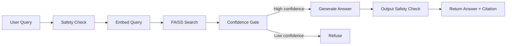

<WhatYouWillLearn>
- Build a 6-stage RAG pipeline from retrieval to answer
- Use FAISS for vector search with cosine similarity
- Add a confidence gate that refuses low-quality answers
- Structure a Python project with centralized config
</WhatYouWillLearn>

<WhyThisMatters>
This lesson is the core of the AI Engineering track. Every other lesson — evaluation, safety, fine-tuning, deployment — builds on the pipeline you create here.
</WhyThisMatters>

<Diagram>

</Diagram>

<Body>
## Project structure

We'll build a Python package with a clear separation of concerns. The key files are `config.py` for constants, `retrieval.py` for FAISS search, and `inference.py` for the pipeline orchestrator.

## Step 1: Centralized config

Every threshold, model ID, and file path lives in one file.

## Step 2: Embedding and retrieval

We use `bge-small-en-v1.5` for embeddings and FAISS `IndexFlatIP` for search. L2-normalize your vectors before indexing so cosine similarity becomes a dot product.

## Step 3: The pipeline

The `answer_question` function orchestrates 6 stages: safety check → embed → retrieve → confidence gate → generate → output safety.
</Body>

<Code>
```python
from retrieval import Retriever
from config import CONFIDENCE_THRESH, LOW_CONFIDENCE_MSG

def answer_question(query: str, retriever: Retriever) -> dict:
    if is_unsafe_query(query):
        return {"answer": SAFETY_MSG, "refused": True}
    results = retriever.search(query, top_k=5)
    if results[0].score < CONFIDENCE_THRESH:
        return {"answer": LOW_CONFIDENCE_MSG, "refused": True}
    context = "\n".join(r.text for r in results)
    answer = generate(query, context)
    if not output_safety_check(answer):
        return {"answer": SAFETY_MSG, "refused": True}
    return {"answer": answer, "sources": results, "refused": False}
```
</Code>

<TryItYourself>
1. Clone the starter repo and run `make install`
2. Build the FAISS index: `python scripts/build_index.py`
3. Run the pipeline: `make demo`
4. Try 3 queries: one good answer, one refusal, one safety block
</TryItYourself>

<CommonMistakes>
- **Forgetting to L2-normalize before IndexFlatIP** — cosine similarity requires normalized vectors
- **Hardcoding the confidence threshold** — put it in `config.py`
- **Skipping the output safety check** — you need both input and output gates
</CommonMistakes>

<DebuggingChecklist>
- [ ] Does `retriever.search()` return scores between 0 and 1?
- [ ] Is the FAISS index built from the same embedding model used at query time?
- [ ] Are passages pre-chunked to reasonable length?
- [ ] Does the confidence threshold produce a reasonable refusal rate?
</DebuggingChecklist>

<MiniQuiz>
**Q: Your RAG pipeline returns confident but wrong answers for 15% of queries. Which component should you investigate first?**

- A) The safety check
- B) The confidence gate — the threshold is too low ✅
- C) The embedding model
- D) The LLM
</MiniQuiz>

<InterviewExplanation>
"I built a 6-stage RAG pipeline: input safety → embed → retrieve → confidence gate → generate → output safety. The confidence gate is the key decision — it lets the system refuse rather than hallucinate."
</InterviewExplanation>

<ResumeBullet>
Built and deployed a domain-specific RAG assistant using FAISS vector search and OpenAI embeddings, with a 6-stage pipeline including confidence-gated retrieval and safety guardrails
</ResumeBullet>

<CompletionChecklist>
- [ ] Built and ran the RAG pipeline locally
- [ ] Tested 3+ queries: good answer, refusal, safety block
- [ ] Can explain pipeline stages in interview format
- [ ] Pushed code to a personal GitHub repo
</CompletionChecklist>
