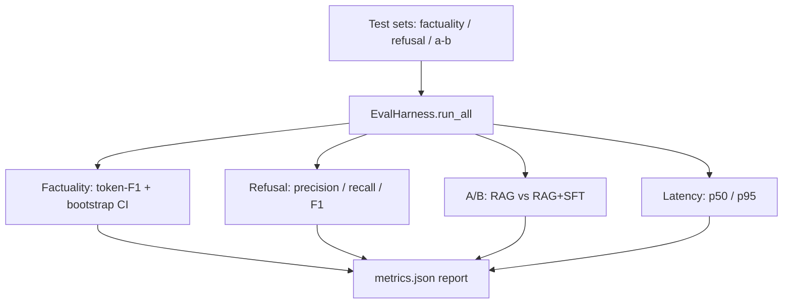

<WhatYouWillLearn>
- Build a reusable eval harness that runs every metric and writes a report
- Compute token-level F1 for factuality against reference answers
- Compute refusal F1 (precision/recall) on a "should refuse" test set
- Attach a bootstrap confidence interval so you don't over-read a number
- Track latency (p50/p95) alongside quality in the same run
</WhatYouWillLearn>

<WhyThisMatters>
"It looks good in the demo" is not a result. Without an eval harness you can't tell whether a change helped, hurt, or did nothing — and you can't defend your system in an interview. A harness that reports factuality, refusal behavior, latency, and a confidence interval is the single most credible artifact in an AI portfolio.
</WhyThisMatters>

<Diagram>

</Diagram>

<Body>
## A harness, not a script

An eval harness is a small class that holds your pipeline and an output directory, runs a suite of checks, and writes a structured report (`metrics.json`). The point is **repeatability**: same command, same numbers, every time you change something.

## Metric 1: Factuality (token F1)

For open-ended answers, exact-match is too strict. **Token F1** compares the bag of (stopword-filtered) words in the prediction vs the reference: precision = how much of the prediction is correct, recall = how much of the reference you covered, F1 = their harmonic mean.

## Metric 2: Refusal F1

Factuality says nothing about whether the system *refused when it should have*. Treat "did it refuse?" as a binary classification against an expected label, and report precision/recall/F1 over your refusal test set. High refusal recall means it rarely answers things it shouldn't.

## Metric 3: Don't over-read one number

A mean F1 of 0.71 on 40 examples could really be anywhere from 0.6 to 0.8. A **bootstrap confidence interval** resamples your scores many times to estimate that range. If two systems' intervals overlap heavily, you can't claim one is better — you need more data.

## Metric 4: Latency in the same breath

Quality without latency is half a picture. Record p50 and p95 latency on the same test queries so a "better" model that's 3× slower doesn't sneak through.
</Body>

<BookNote chapter="4">

Chapter 4 walks through building an evaluation pipeline for a real system rather than for a
model in isolation. Huyen recommends judging each component on its own as well as the whole
flow: if retrieval fails, a perfect generator still produces a bad answer, and an end-to-end
score alone will not tell you which part broke.

Before writing any code, decide what good looks like. Write a short guideline that describes the
criteria, with scoring rules and real examples of good and bad outputs for each score. Without
that, two people, or two judge prompts, will grade the same answer differently.

Then decide on data. Keep test examples that reflect real usage, and split results into slices,
for example by user type, topic or input length, because an average can hide a group that is
doing badly. Finally, ask how many examples you need for a result you can trust: if a small
change in the test set flips your conclusion, the set is too small. An eval harness is a living
tool that grows as you learn where the app fails.

Further reading: Chip Huyen, AI Engineering (O'Reilly, 2025), chapter 4

</BookNote>

<Code>
```python
import re, random
from collections import Counter

_STOP = frozenset(["a", "an", "the", "is", "are", "of", "in", "to", "for", "and", "or"])

def token_f1(pred: str, ref: str) -> float:
    def toks(t): 
        return Counter(w for w in re.findall(r"\b\w+\b", t.lower()) if w not in _STOP)
    p, r = toks(pred), toks(ref)
    if not p or not r:
        return 0.0
    common = sum((p & r).values())
    precision, recall = common / sum(p.values()), common / sum(r.values())
    return 0.0 if precision + recall == 0 else 2 * precision * recall / (precision + recall)

def bootstrap_ci(scores: list[float], n: int = 1000) -> tuple[float, float]:
    k = len(scores)
    if k == 0:
        return 0.0, 0.0
    means = sorted(sum(random.choices(scores, k=k)) / k for _ in range(n))
    return means[int(0.025 * n)], means[int(0.975 * n)]

class EvalHarness:
    def __init__(self, pipeline, output_dir):
        self.pipeline = pipeline
        self.output_dir = output_dir

    def run_factuality(self, records: list[dict]) -> dict:
        scores = [token_f1(self.pipeline.answer(r["question"]), r["reference_answer"])
                  for r in records]
        lo, hi = bootstrap_ci(scores)
        return {"mean_f1": sum(scores) / len(scores), "ci_low": lo, "ci_high": hi, "n": len(scores)}

    def run_refusal_f1(self, records: list[dict], refusal_msg: str) -> dict:
        tp = fp = fn = 0
        for r in records:
            refused = self.pipeline.answer(r["query"]) == refusal_msg
            expected = r.get("expected_refused", False)
            tp += refused and expected
            fp += refused and not expected
            fn += (not refused) and expected
        prec = tp / (tp + fp) if tp + fp else 0.0
        rec = tp / (tp + fn) if tp + fn else 0.0
        f1 = 2 * prec * rec / (prec + rec) if prec + rec else 0.0
        return {"precision": prec, "recall": rec, "f1": f1}
```
</Code>

<TryItYourself>
1. Build a `factuality.jsonl` with 20 `{question, reference_answer}` pairs
2. Run `run_factuality` and record mean F1 with its CI
3. Build a `refusal_eval.jsonl` with `expected_refused` labels and run `run_refusal_f1`
4. Make a small change to your prompt and re-run; decide if the CIs overlap
5. Add p50/p95 latency capture and write everything to `metrics.json`
</TryItYourself>

<CommonMistakes>
- **Reporting a single mean with no interval** — you'll claim wins that are noise
- **Using exact-match for open-ended answers** — token F1 is the right granularity
- **Evaluating only factuality** — a system that never refuses can score well and still be unsafe
- **Tiny test sets** — 10 examples give intervals so wide every comparison is inconclusive
- **Comparing across different test sets** — A/B must run on the same items
- **Ignoring latency** — a "better" model that's 3× slower may be worse in production
</CommonMistakes>

<DebuggingChecklist>
- [ ] Does `token_f1` return 0 when prediction or reference is empty (not a crash)?
- [ ] Are stopwords filtered consistently on both sides?
- [ ] Is the refusal check comparing against the exact refusal message your pipeline emits?
- [ ] Does the bootstrap use the same number of resamples each run for comparability?
- [ ] Are test sets deduped against training data (no leakage)?
- [ ] Is `metrics.json` overwritten or versioned per run so you can diff?
</DebuggingChecklist>

<MiniQuiz>
**Q: Your new prompt raises mean F1 from 0.70 to 0.73, but the 95% bootstrap CIs are [0.62, 0.78] and [0.65, 0.81]. What can you conclude?**

- A) The new prompt is clearly better
- B) The intervals overlap heavily — you can't claim an improvement; collect more data ✅
- C) The metric is broken
- D) F1 is the wrong metric here
</MiniQuiz>

<InterviewExplanation>
"My eval harness is a class that holds the pipeline, runs a metric suite, and writes metrics.json so results are repeatable. For factuality I use token-level F1 against reference answers, because exact match is too strict for open-ended text. For safety I compute refusal F1 — precision and recall on a 'should refuse' set — since a system that never refuses can still score well on factuality. I attach a bootstrap confidence interval to every mean so I don't over-read a 3-point bump that's really noise, and I capture p50/p95 latency in the same run so quality and speed are judged together."
</InterviewExplanation>

<ResumeBullet>
Built a reusable evaluation harness reporting token-F1 factuality, refusal precision/recall, and p50/p95 latency with bootstrap confidence intervals, enabling data-driven A/B comparisons of RAG and fine-tuned variants
</ResumeBullet>

<CompletionChecklist>
- [ ] Implemented token F1 and bootstrap CI
- [ ] Implemented refusal F1 against expected labels
- [ ] Ran the full harness and produced a `metrics.json` report
- [ ] Used overlapping/non-overlapping CIs to make a real keep/revert decision
- [ ] Captured latency alongside quality
</CompletionChecklist>
