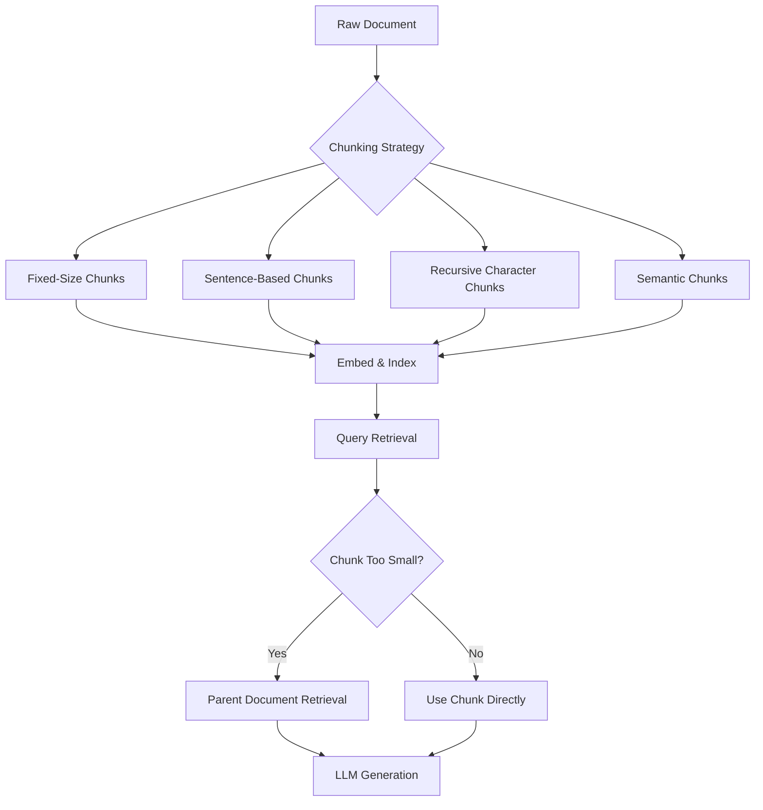

<WhatYouWillLearn>
- Explain why chunking is the highest-leverage knob in a RAG pipeline
- Implement fixed-size, sentence-based, and recursive character chunking
- Use overlap to preserve context at chunk boundaries
- Apply parent-document retrieval for better answer generation
- Measure chunking quality with retrieval metrics
</WhatYouWillLearn>

<WhyThisMatters>
Most RAG tutorials skip chunking or use a default 500-token split. In practice, chunking strategy has more impact on retrieval quality than the choice of embedding model. Bad chunks mean bad retrieval, and no amount of prompt engineering or model swapping can fix that. Knowing how to chunk well is one of the most practical skills an AI engineer can have.
</WhyThisMatters>

<Diagram>

</Diagram>

<Body>
## Why chunking matters so much

When you embed a document, you're compressing its meaning into a single vector. A 10-page document compressed into 384 floats loses almost all its specificity — the vector becomes an average of everything, good at matching nothing in particular. That's why you chunk: you split documents into smaller pieces so each embedding captures a focused meaning.

But chunk badly and you get the opposite problem: chunks that split mid-sentence, lose critical context, or are so small they match too many unrelated queries.

## Strategy 1: Fixed-size chunking

Split the text every N characters (or tokens), regardless of content boundaries.

```python
def fixed_size_chunk(text: str, chunk_size: int = 500, overlap: int = 100) -> list[str]:
    chunks = []
    start = 0
    while start < len(text):
        end = start + chunk_size
        chunks.append(text[start:end])
        start = end - overlap
    return chunks
```

**Pros**: Simple, predictable chunk sizes, easy to reason about token budgets.

**Cons**: Splits mid-sentence and mid-paragraph. A sentence like "The refund policy applies to annual plans only" might get split into "The refund policy applies to ann" and "ual plans only" — neither chunk is useful.

**When to use**: Quick prototyping only. Almost always upgrade to a better strategy.

## Strategy 2: Sentence-based chunking

Split on sentence boundaries, then group sentences until you hit a size limit.

```python
import re

def sentence_chunk(text: str, max_tokens: int = 200) -> list[str]:
    sentences = re.split(r'(?<=[.!?])\s+', text)
    chunks, current = [], []
    current_len = 0
    
    for sent in sentences:
        sent_len = len(sent.split())
        if current_len + sent_len > max_tokens and current:
            chunks.append(" ".join(current))
            current, current_len = [], 0
        current.append(sent)
        current_len += sent_len
    
    if current:
        chunks.append(" ".join(current))
    return chunks
```

**Pros**: Preserves sentence boundaries. Each chunk is at least grammatically coherent.

**Cons**: Doesn't respect higher-level structure (paragraphs, sections). A chunk might contain the last sentence of one section and the first sentence of the next.

**When to use**: General-purpose text without strong structure (blog posts, transcripts).

## Strategy 3: Recursive character chunking

This is LangChain's default and the most popular production strategy. It tries to split on paragraphs first, then sentences, then words, then characters — recursively falling back until each chunk fits the size limit.

```python
def recursive_chunk(text: str, max_size: int = 500, separators: list[str] = None) -> list[str]:
    if separators is None:
        separators = ["\n\n", "\n", ". ", " ", ""]
    
    if len(text) <= max_size:
        return [text]
    
    for sep in separators:
        if sep in text:
            parts = text.split(sep)
            chunks = []
            current = ""
            for part in parts:
                candidate = current + sep + part if current else part
                if len(candidate) <= max_size:
                    current = candidate
                else:
                    if current:
                        chunks.append(current)
                    current = part
            if current:
                chunks.append(current)
            
            # Recursively handle chunks that are still too large
            result = []
            for chunk in chunks:
                if len(chunk) <= max_size:
                    result.append(chunk)
                else:
                    result.extend(recursive_chunk(chunk, max_size, separators[1:]))
            return result
    
    # Last resort: hard split
    return [text[i:i+max_size] for i in range(0, len(text), max_size)]
```

**Pros**: Respects document structure. Paragraphs stay intact when possible.

**Cons**: More complex. Chunk sizes vary, which can affect embedding quality for models sensitive to input length.

**When to use**: Structured documents (documentation, articles, reports). This is the best default.

## The overlap problem

When you split text, the boundary between chunk N and chunk N+1 loses context. The answer to a question might span two chunks.

**Overlap** solves this by repeating the last K characters of chunk N at the start of chunk N+1. Typical overlap is 10-20% of chunk size.

```python
# Adding overlap to sentence chunking
def sentence_chunk_with_overlap(text: str, max_tokens: int = 200, overlap_sentences: int = 2):
    sentences = re.split(r'(?<=[.!?])\s+', text)
    chunks, current = [], []
    current_len = 0
    
    for i, sent in enumerate(sentences):
        sent_len = len(sent.split())
        if current_len + sent_len > max_tokens and current:
            chunks.append(" ".join(current))
            # Keep last N sentences for overlap
            current = current[-overlap_sentences:]
            current_len = sum(len(s.split()) for s in current)
        current.append(sent)
        current_len += sent_len
    
    if current:
        chunks.append(" ".join(current))
    return chunks
```

Too much overlap wastes storage and token budget. Too little overlap loses boundary context. Start with 10-15% and tune based on retrieval metrics.

## Strategy 4: Parent-document retrieval

This is the advanced pattern used in production systems. The idea: embed *small* chunks for precise retrieval, but pass the *parent* document (or a larger surrounding chunk) to the LLM for generation.

Why? Small chunks (100-200 tokens) match queries more precisely, but they lack the surrounding context the LLM needs to generate a good answer. A 2-sentence chunk might match perfectly but not contain enough information for a complete answer.

```python
class ParentDocumentRetriever:
    def __init__(self, small_index, parent_store):
        self.small_index = small_index      # FAISS index of small chunks
        self.parent_store = parent_store    # Mapping: small_chunk_id -> parent_text
    
    def search(self, query: str, k: int = 5):
        # Retrieve small chunks for precision
        small_results = self.small_index.search(query, k=k)
        
        # Expand to parent chunks for context
        parent_ids = set()
        parents = []
        for result in small_results:
            pid = self.parent_store[result.id]["parent_id"]
            if pid not in parent_ids:
                parent_ids.add(pid)
                parents.append(self.parent_store[result.id]["parent_text"])
        
        return parents
```

## How to measure chunking quality

The only way to know if your chunking strategy is good is to measure retrieval metrics on a test set.

1. Create test queries with labeled relevant documents
2. Chunk your corpus with strategy A, embed, and build an index
3. Measure precision@5, recall@5, and MRR
4. Repeat with strategy B
5. Pick the strategy with better metrics

**Don't trust intuition.** A strategy that looks clever (semantic chunking, for example) might perform worse than simple recursive chunking on your specific corpus.

## Practical guidelines

| Document type | Recommended strategy | Chunk size | Overlap |
|---|---|---|---|
| Technical docs | Recursive character | 400-600 tokens | 50-100 tokens |
| Legal contracts | Sentence-based | 200-300 tokens | 2-3 sentences |
| Chat transcripts | Fixed-size | 300-500 tokens | 50 tokens |
| Code files | Split on functions/classes | Varies | None |
| PDFs with tables | Custom parser + table extraction | Per-table | None |

The best chunking strategy is the one you've measured, not the one a tutorial recommended.
</Body>

<Code>
```python
import re
from sentence_transformers import SentenceTransformer
import faiss
import numpy as np

# Sample document
document = """
Machine learning models require training data to learn patterns. The quality of 
training data directly affects model performance. Garbage in, garbage out.

Data preprocessing is a critical step. This includes cleaning, normalization, 
and feature engineering. Missing values must be handled before training.

Model evaluation uses metrics like accuracy, precision, recall, and F1 score. 
Cross-validation helps estimate how well the model generalizes to unseen data. 
A model that performs well on training data but poorly on test data is overfitting.

Regularization techniques like L1, L2, and dropout help prevent overfitting. 
They add constraints to the model to reduce complexity.
"""

# Compare two chunking strategies
def fixed_chunk(text, size=200, overlap=50):
    chunks, start = [], 0
    while start < len(text):
        chunks.append(text[start:start+size].strip())
        start += size - overlap
    return [c for c in chunks if c]

def sentence_chunk(text, max_chars=200):
    sentences = re.split(r'(?<=[.!?])\s+', text.strip())
    chunks, current = [], ""
    for sent in sentences:
        if len(current) + len(sent) > max_chars and current:
            chunks.append(current.strip())
            current = ""
        current += " " + sent
    if current.strip():
        chunks.append(current.strip())
    return chunks

fixed = fixed_chunk(document)
sentence = sentence_chunk(document)

print(f"Fixed chunks: {len(fixed)}")
for i, c in enumerate(fixed):
    print(f"  [{i}] {c[:80]}...")

print(f"\nSentence chunks: {len(sentence)}")
for i, c in enumerate(sentence):
    print(f"  [{i}] {c[:80]}...")
```
</Code>

<TryItYourself>
1. Take a 2-page document (your class notes, a Wikipedia article, anything)
2. Chunk it using fixed-size, sentence-based, and recursive strategies
3. Embed all chunks and build a FAISS index for each
4. Write 5 test queries and compare which strategy retrieves the best chunks
5. Try varying chunk sizes (200, 400, 800 tokens) and measure the impact
</TryItYourself>

<CompletionChecklist>
- [ ] Implemented at least two chunking strategies in Python
- [ ] Compared retrieval quality between strategies on real text
- [ ] Added overlap to at least one strategy
- [ ] Can explain parent-document retrieval and when to use it
- [ ] Measured retrieval metrics to pick the best strategy
</CompletionChecklist>

<CommonMistakes>
- **Using a single chunk size for all document types** — code, legal text, and chat transcripts need different strategies
- **No overlap between chunks** — you'll lose answers that span chunk boundaries
- **Chunks that are too small** — 50-token chunks match too many queries and lack context for generation
- **Chunks that are too large** — 2000-token chunks produce generic embeddings that match nothing precisely
- **Not measuring** — choosing a chunking strategy based on intuition instead of retrieval metrics
</CommonMistakes>

<DebuggingChecklist>
- [ ] Are chunk sizes consistent with the embedding model's max input length?
- [ ] Do chunks preserve sentence boundaries (no mid-sentence splits)?
- [ ] Is overlap configured (10-20% of chunk size)?
- [ ] Are empty or whitespace-only chunks filtered out?
- [ ] Does retrieval quality improve when you switch strategies?
- [ ] For parent-document retrieval: does the parent mapping correctly link small chunks to their parents?
</DebuggingChecklist>

<MiniQuiz>
**Q: Your RAG system retrieves highly relevant small chunks, but the LLM generates incomplete answers. What pattern should you add?**

- A) Increase chunk size to 2000 tokens
- B) Parent-document retrieval — retrieve small, generate from large ✅
- C) Remove overlap to reduce noise
- D) Switch to a bigger embedding model
</MiniQuiz>

<InterviewExplanation>
"Chunking strategy has more impact on RAG quality than the embedding model choice. I start with recursive character chunking — it respects paragraph and sentence boundaries while keeping chunks within a token budget. I add 10-15% overlap so I don't lose answers at chunk boundaries. For production systems, I use parent-document retrieval: embed small chunks for precise matching, but pass the larger parent section to the LLM so it has enough context to generate a complete answer. I always measure chunking quality with precision@k and recall@k on a labeled test set rather than relying on intuition."
</InterviewExplanation>

<ResumeBullet>
Evaluated and implemented chunking strategies (recursive, sentence-based, parent-document retrieval) for a RAG pipeline, improving retrieval precision@5 by measuring against labeled test sets
</ResumeBullet>
