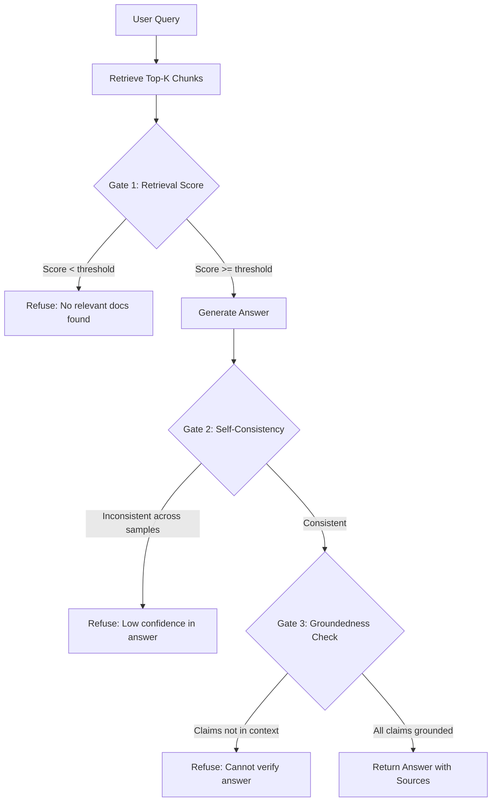

<WhatYouWillLearn>
- Define what a confidence gate is and where it sits in the RAG pipeline
- Implement retrieval-score gates and LLM-based self-consistency checks
- Tune thresholds using precision-recall tradeoffs
- Handle refusals gracefully with fallback behavior
- Avoid the most dangerous failure mode: confidently wrong answers
</WhatYouWillLearn>

<WhyThisMatters>
The worst thing a RAG system can do is give a confident, wrong answer. Users trust AI-generated text, especially when it cites sources. A confidence gate is the mechanism that says "I don't have enough information to answer this reliably" — and that refusal is the single most important safety feature in a production RAG pipeline. Interviewers ask about this because it separates engineers who've deployed AI from those who've only built demos.
</WhyThisMatters>

<Diagram>

</Diagram>

<Body>
## What is a confidence gate?

A confidence gate is a checkpoint in your RAG pipeline that decides whether the system has enough evidence to answer. If the evidence is weak, the system refuses to answer rather than risking a hallucinated response.

There are three places to put gates, and production systems often use all three:

1. **After retrieval** — are the retrieved documents actually relevant to the query?
2. **After generation** — is the generated answer consistent across multiple samples?
3. **Before output** — is every claim in the answer grounded in the retrieved context?

## Gate 1: Retrieval score threshold

The simplest gate checks the similarity score of the top retrieved document. If the best match isn't similar enough to the query, the retrieved documents probably aren't relevant.

```python
def retrieval_gate(scores: list[float], threshold: float = 0.75) -> bool:
    """Returns True if retrieval is confident enough to proceed."""
    if not scores:
        return False
    return scores[0] >= threshold

# In the pipeline
scores, doc_ids = index.search(query_embedding, k=5)
if not retrieval_gate(scores[0].tolist(), threshold=config.RETRIEVAL_THRESHOLD):
    return {
        "answer": "I don't have enough information to answer this question.",
        "refused": True,
        "reason": "low_retrieval_score",
        "top_score": float(scores[0][0])
    }
```

### Choosing the threshold

This is the hard part. Too high and the system refuses valid questions. Too low and it hallucinates.

The right approach is empirical:

1. Collect 50+ query-answer pairs with relevance labels
2. For each query, record the top retrieval score
3. Plot a precision-recall curve by varying the threshold
4. Pick the threshold where precision is high enough for your use case

```python
import numpy as np

def find_optimal_threshold(scores: list[float], labels: list[bool], 
                           min_precision: float = 0.9) -> float:
    """Find the lowest threshold that achieves the target precision."""
    thresholds = np.arange(0.5, 1.0, 0.01)
    for t in thresholds:
        predictions = [s >= t for s in scores]
        true_positives = sum(p and l for p, l in zip(predictions, labels))
        predicted_positives = sum(predictions)
        precision = true_positives / predicted_positives if predicted_positives else 0
        if precision >= min_precision:
            recall = true_positives / sum(labels) if sum(labels) else 0
            print(f"Threshold={t:.2f}, Precision={precision:.2f}, Recall={recall:.2f}")
            return t
    return 0.95  # Conservative fallback
```

## Gate 2: Self-consistency check

Even with relevant documents, the LLM might generate different answers depending on random sampling. If you generate the same answer 3 times with temperature > 0 and get 3 different responses, the model is uncertain.

```python
def self_consistency_gate(query: str, context: str, n_samples: int = 3,
                          temperature: float = 0.7) -> dict:
    """Generate multiple answers and check consistency."""
    answers = []
    for _ in range(n_samples):
        answer = generate(query, context, temperature=temperature)
        answers.append(answer)
    
    # Use an LLM to judge consistency
    consistency_prompt = f"""Given these {n_samples} answers to the same question,
are they substantively consistent (same core facts, same conclusion)?

Question: {query}
Answers:
{chr(10).join(f'{i+1}. {a}' for i, a in enumerate(answers))}

Respond with: CONSISTENT or INCONSISTENT and a brief explanation."""
    
    judgment = call_llm(consistency_prompt, temperature=0)
    is_consistent = "CONSISTENT" in judgment.upper().split("\n")[0]
    
    return {
        "consistent": is_consistent,
        "answers": answers,
        "judgment": judgment
    }
```

**Cost tradeoff**: This gate multiplies your LLM calls by N. In production, use it selectively — only on queries where the retrieval score is borderline (e.g., between 0.75 and 0.85).

## Gate 3: Groundedness check

This is the most thorough gate. After generating an answer, decompose it into individual claims and verify each one against the retrieved context.

```python
def groundedness_gate(answer: str, context: str) -> dict:
    """Check if every claim in the answer is supported by the context."""
    decompose_prompt = f"""Extract every factual claim from this answer as a JSON list of strings.

Answer: {answer}

Output: ["claim1", "claim2", ...]"""
    
    claims = json.loads(call_llm(decompose_prompt, temperature=0))
    
    results = []
    for claim in claims:
        verify_prompt = f"""Is this claim supported by the context? Answer SUPPORTED or NOT SUPPORTED.

Claim: {claim}
Context: {context}

Answer:"""
        verdict = call_llm(verify_prompt, temperature=0)
        supported = "SUPPORTED" in verdict.upper() and "NOT SUPPORTED" not in verdict.upper()
        results.append({"claim": claim, "supported": supported})
    
    supported_count = sum(1 for r in results if r["supported"])
    groundedness_score = supported_count / len(results) if results else 0.0
    
    return {
        "score": groundedness_score,
        "claims": results,
        "passed": groundedness_score >= 0.9  # Require 90%+ claims grounded
    }
```

## Handling refusals gracefully

A blunt "I don't know" is better than a hallucination, but you can do better:

```python
REFUSAL_TEMPLATES = {
    "low_retrieval_score": (
        "I couldn't find relevant information to answer this question. "
        "Could you rephrase it, or let me know which specific topic you're asking about?"
    ),
    "inconsistent_answers": (
        "I found some related information but I'm not confident enough in the answer. "
        "Here's what I found — please verify with the original source: {partial_answer}"
    ),
    "ungrounded_claims": (
        "My answer contained claims I couldn't verify against the source documents. "
        "Here are the verified parts: {grounded_portion}"
    ),
}
```

The key principle: **refuse with context**. Tell the user *why* you can't answer and *what they can do* (rephrase, provide more context, check the source directly).

## Putting it all together

```python
def answer_with_gates(query: str, retriever, config) -> dict:
    # Gate 1: Retrieval confidence
    results = retriever.search(query, k=5)
    if results[0].score < config.RETRIEVAL_THRESHOLD:
        return refuse("low_retrieval_score", top_score=results[0].score)
    
    context = "\n".join(r.text for r in results)
    
    # Gate 2: Self-consistency (only for borderline retrieval)
    if results[0].score < config.CONSISTENCY_CHECK_THRESHOLD:
        consistency = self_consistency_gate(query, context)
        if not consistency["consistent"]:
            return refuse("inconsistent_answers", 
                         partial_answer=consistency["answers"][0])
    
    # Generate answer
    answer = generate(query, context, temperature=0)
    
    # Gate 3: Groundedness
    groundedness = groundedness_gate(answer, context)
    if not groundedness["passed"]:
        grounded_claims = [c["claim"] for c in groundedness["claims"] if c["supported"]]
        return refuse("ungrounded_claims", 
                      grounded_portion=". ".join(grounded_claims))
    
    return {"answer": answer, "sources": results, "refused": False,
            "groundedness": groundedness["score"]}
```

## Monitoring refusal rates

In production, track:
- **Overall refusal rate** — if it's above 30%, your retrieval needs work, not your gates
- **Refusal reason breakdown** — which gate triggers most often tells you where to improve
- **User satisfaction after refusal** — do users rephrase and get answers, or do they leave?
- **False refusals** — cases where the system refused but should have answered (measure with labeled data)

A healthy system refuses 5-15% of queries. Below 5% means your gates are too loose. Above 20% means your retrieval or corpus has gaps.
</Body>

<Code>
```python
from dataclasses import dataclass

@dataclass
class GateResult:
    passed: bool
    reason: str
    score: float
    details: dict = None

def retrieval_gate(top_score: float, threshold: float = 0.75) -> GateResult:
    passed = top_score >= threshold
    return GateResult(
        passed=passed,
        reason="retrieval_score" if not passed else "ok",
        score=top_score,
        details={"threshold": threshold}
    )

def score_spread_gate(scores: list[float], min_gap: float = 0.15) -> GateResult:
    """Check that the top result is meaningfully better than the rest."""
    if len(scores) < 2:
        return GateResult(passed=True, reason="ok", score=1.0)
    gap = scores[0] - scores[1]
    passed = gap >= min_gap
    return GateResult(
        passed=passed,
        reason="ambiguous_results" if not passed else "ok",
        score=gap,
        details={"top_score": scores[0], "second_score": scores[1]}
    )

# Usage
scores = [0.82, 0.80, 0.65, 0.41, 0.30]
g1 = retrieval_gate(scores[0], threshold=0.75)
g2 = score_spread_gate(scores, min_gap=0.15)

print(f"Retrieval gate: {'PASS' if g1.passed else 'FAIL'} (score={g1.score:.2f})")
print(f"Spread gate: {'PASS' if g2.passed else 'FAIL'} (gap={g2.score:.2f})")
```
</Code>

<TryItYourself>
1. Build a simple RAG pipeline with FAISS (use Lesson 3's code as a starting point)
2. Add a retrieval score gate with a threshold of 0.75
3. Test 10 queries: 5 that should be answered, 5 that should be refused
4. Adjust the threshold until you get no false positives (wrong answers let through)
5. Count how many valid queries get refused — that's your false refusal rate
</TryItYourself>

<CompletionChecklist>
- [ ] Implemented a retrieval score gate
- [ ] Tested with queries that should be refused
- [ ] Tuned the threshold using at least 10 test cases
- [ ] Can explain the precision-recall tradeoff of threshold tuning
- [ ] Implemented graceful refusal messages (not just "I don't know")
</CompletionChecklist>

<CommonMistakes>
- **Hardcoding a threshold without measuring** — 0.75 might be wildly wrong for your model and data
- **Using the same threshold for all query types** — factual lookups need higher thresholds than open-ended questions
- **Not tracking refusal rates in production** — you won't know if the gate is too aggressive or too loose
- **Refusing without explanation** — "I don't know" is worse than "I couldn't find relevant information; try rephrasing"
- **Running all three gates on every query** — self-consistency and groundedness are expensive; use them selectively
</CommonMistakes>

<DebuggingChecklist>
- [ ] Is the retrieval threshold calibrated on labeled data, not guessed?
- [ ] Do refusal messages explain why and suggest next steps?
- [ ] Is the refusal rate between 5% and 20% in production?
- [ ] Are borderline cases (score near threshold) being logged for review?
- [ ] Does the self-consistency check use temperature > 0 for diverse samples?
- [ ] Is the groundedness check decomposing claims individually, not checking the whole answer at once?
</DebuggingChecklist>

<MiniQuiz>
**Q: Your RAG system has a 40% refusal rate. Users are complaining they can't get answers. What should you investigate first?**

- A) Lower the confidence threshold
- B) Check if the corpus has gaps — 40% refusal often means missing documents ✅
- C) Remove the confidence gate entirely
- D) Switch to a larger LLM
</MiniQuiz>

<InterviewExplanation>
"I implement confidence gates at three points: after retrieval, I check if the top similarity score exceeds a calibrated threshold. For borderline scores, I run a self-consistency check — generate the answer 3 times and verify consistency. Before output, I decompose the answer into claims and verify each one is grounded in the retrieved context. The threshold is tuned empirically on labeled data, targeting high precision at the cost of some recall — it's better to refuse than to hallucinate. In production, I monitor the refusal rate; if it exceeds 15-20%, the problem is usually corpus gaps, not gate calibration."
</InterviewExplanation>

<ResumeBullet>
Designed and calibrated a three-layer confidence gating system (retrieval threshold, self-consistency, groundedness) for a production RAG pipeline, reducing hallucinated responses by enforcing evidence-backed answer generation
</ResumeBullet>
