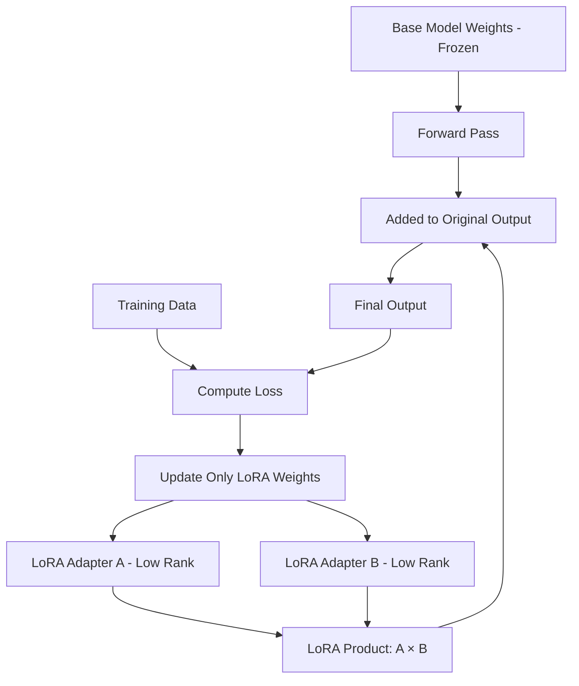

<WhatYouWillLearn>
- Explain what LoRA is and why it makes fine-tuning accessible
- Identify when fine-tuning is worth the cost over RAG alone
- Prepare a training dataset from domain-specific examples
- Fine-tune a small model using Hugging Face PEFT and LoRA
- Evaluate fine-tuned vs base model performance on domain tasks
</WhatYouWillLearn>

<WhyThisMatters>
RAG handles most production needs, but some problems require changing the model itself — domain-specific terminology, consistent output formatting, or specialized reasoning the base model can't learn from context alone. LoRA (Low-Rank Adaptation) lets you fine-tune a model by updating less than 1% of its parameters, making it feasible on a single GPU. This is the fallback when RAG isn't enough, and knowing when and how to use it is a senior-level AI engineering skill.
</WhyThisMatters>

<Diagram>

</Diagram>

<Body>
## What LoRA does

Standard fine-tuning updates all parameters in a model. A 7B parameter model requires 7B gradient updates per training step — that's 28GB of memory just for the gradients in float32. LoRA sidesteps this by freezing the original weights and injecting small trainable matrices into each layer.

The key insight: the weight updates during fine-tuning tend to be **low-rank**. Instead of learning a full weight update matrix W (dimensions d x d), LoRA decomposes it into two small matrices: A (d x r) and B (r x d), where r (the rank) is much smaller than d — typically 8, 16, or 32.

```
Original: output = W @ input
LoRA:     output = W @ input + (A @ B) @ input
```

The original weights W are frozen. Only A and B are trained. For a rank of 16 on a layer with dimension 4096, that's 4096 x 16 + 16 x 4096 = 131,072 trainable parameters per layer, instead of 4096 x 4096 = 16.7 million.

Across an entire model, LoRA typically trains 0.1% to 1% of total parameters.

## When to use fine-tuning (and when not to)

**Fine-tune when:**
- The model consistently fails on domain-specific language despite good RAG context (medical terminology, legal jargon, proprietary code syntax)
- You need a specific output format that prompt engineering can't reliably enforce
- You want to distill a large model's behavior into a smaller, cheaper model
- Your use case requires consistent tone/personality that varies with prompting

**Don't fine-tune when:**
- RAG alone solves the problem — fine-tuning adds complexity for no gain
- Your training data has fewer than 100 high-quality examples
- The knowledge changes frequently — fine-tuned knowledge is frozen at training time
- You haven't tried few-shot prompting with good examples first

## Preparing training data

The most important and most underestimated step. Your training data needs to be:

1. **Formatted as instruction-response pairs** — the model learns to follow the pattern
2. **High-quality** — errors in training data become errors in the model
3. **Representative** — covers the range of tasks you need
4. **Deduplicated** — repeated examples cause overfitting

```python
# Training data format for instruction tuning
training_examples = [
    {
        "instruction": "Summarize this radiology report in plain language for the patient.",
        "input": "FINDINGS: There is a 2.3cm hypodense lesion in segment VII of the liver...",
        "output": "The scan found a small spot (about 1 inch) on the right side of your liver. This kind of spot is very common and usually not dangerous, but your doctor may want to do a follow-up scan in 6 months to make sure it hasn't changed."
    },
    {
        "instruction": "Extract the key measurements from this pathology report.",
        "input": "GROSS DESCRIPTION: Received in formalin is a 4.5 x 3.2 x 2.8 cm...",
        "output": "Specimen dimensions: 4.5 x 3.2 x 2.8 cm\nTumor size: 1.8 cm\nMargins: closest margin 0.4 cm (anterior)"
    },
]
```

### How many examples do you need?

| Task complexity | Minimum examples | Recommended |
|---|---|---|
| Style/format adaptation | 50-100 | 200-500 |
| Domain vocabulary | 100-300 | 500-1000 |
| New reasoning patterns | 500-1000 | 2000-5000 |

More data is almost always better, but quality matters more than quantity. 200 expert-written examples beat 2000 auto-generated ones.

## Fine-tuning with Hugging Face PEFT

Here's the actual training loop using the PEFT library:

```python
from transformers import AutoModelForCausalLM, AutoTokenizer, TrainingArguments
from peft import LoraConfig, get_peft_model, TaskType
from trl import SFTTrainer
from datasets import Dataset

# 1. Load base model
model_name = "mistralai/Mistral-7B-Instruct-v0.3"
model = AutoModelForCausalLM.from_pretrained(
    model_name,
    torch_dtype="auto",
    device_map="auto",
)
tokenizer = AutoTokenizer.from_pretrained(model_name)
tokenizer.pad_token = tokenizer.eos_token

# 2. Configure LoRA
lora_config = LoraConfig(
    task_type=TaskType.CAUSAL_LM,
    r=16,                        # Rank — higher = more expressive, more memory
    lora_alpha=32,               # Scaling factor — usually 2x rank
    lora_dropout=0.05,           # Regularization
    target_modules=["q_proj", "v_proj"],  # Which layers to adapt
)

model = get_peft_model(model, lora_config)
model.print_trainable_parameters()
# Output: trainable params: 4,194,304 || all params: 7,245,119,488 || trainable%: 0.058%

# 3. Prepare dataset
def format_example(example):
    return f"### Instruction:\n{example['instruction']}\n\n### Input:\n{example['input']}\n\n### Response:\n{example['output']}"

dataset = Dataset.from_list(training_examples)
dataset = dataset.map(lambda x: {"text": format_example(x)})

# 4. Train
training_args = TrainingArguments(
    output_dir="./lora-medical",
    num_train_epochs=3,
    per_device_train_batch_size=4,
    gradient_accumulation_steps=4,
    learning_rate=2e-4,
    warmup_steps=50,
    logging_steps=10,
    save_strategy="epoch",
    fp16=True,
)

trainer = SFTTrainer(
    model=model,
    train_dataset=dataset,
    args=training_args,
    dataset_text_field="text",
    max_seq_length=1024,
)

trainer.train()

# 5. Save the adapter (not the full model)
model.save_pretrained("./lora-medical-adapter")
```

## Key hyperparameters

| Parameter | Default | Notes |
|---|---|---|
| `r` (rank) | 8-16 | Higher rank = more capacity but more memory. Start with 16. |
| `lora_alpha` | 2x rank | Scaling factor. Higher alpha = LoRA contributes more to output. |
| `target_modules` | `["q_proj", "v_proj"]` | Which attention matrices to adapt. Adding `k_proj`, `o_proj` increases capacity. |
| `learning_rate` | 1e-4 to 3e-4 | Too high = catastrophic forgetting. Too low = no learning. |
| `epochs` | 2-5 | More epochs on small datasets = overfitting. Monitor val loss. |

## Evaluating the fine-tuned model

Never just eyeball outputs. Compare the fine-tuned model against the base model on a held-out test set:

```python
from peft import PeftModel

# Load fine-tuned model
base_model = AutoModelForCausalLM.from_pretrained(model_name, device_map="auto")
ft_model = PeftModel.from_pretrained(base_model, "./lora-medical-adapter")

# Compare on test cases
test_cases = load_test_set("test_cases.json")  # 20+ held-out examples

base_scores = evaluate_model(base_model, tokenizer, test_cases)
ft_scores = evaluate_model(ft_model, tokenizer, test_cases)

print(f"Base model accuracy: {base_scores['accuracy']:.2%}")
print(f"Fine-tuned accuracy: {ft_scores['accuracy']:.2%}")
print(f"Improvement: {ft_scores['accuracy'] - base_scores['accuracy']:.2%}")
```

If the fine-tuned model doesn't meaningfully outperform the base model with good prompting, fine-tuning wasn't worth it. This happens more often than people admit.

## Combining LoRA with RAG

Fine-tuning and RAG are complementary:
- **RAG** provides up-to-date knowledge and citations
- **LoRA** provides domain-specific language and behavior

```python
# The fine-tuned model still uses RAG for retrieval
def answer_with_finetuned_rag(query, retriever, ft_model, tokenizer):
    context = retriever.search(query, k=5)
    prompt = format_rag_prompt(query, context)
    return generate(ft_model, tokenizer, prompt)
```

The fine-tuned model produces better answers from the same retrieved context because it understands domain terminology and formatting conventions the base model doesn't.
</Body>

<BookNote chapter="7">

Chapter 7 starts with when to finetune at all. A useful rule from Huyen: retrieval mainly fixes
missing facts, while finetuning mainly fixes behaviour, such as format, style or following a
specific kind of instruction. Try prompting and retrieval first; finetune when they are not
enough and you have good data.

Full finetuning updates every weight, which needs a lot of GPU memory for the weights, their
gradients and the optimizer state. Parameter-efficient methods avoid this by training a small
number of new parameters. LoRA is the best-known one. It leaves the original weight matrices
frozen and learns a pair of thin matrices whose product is added to them, so the update is low
rank and tiny compared with the full model.

That design has practical benefits. Training fits on smaller hardware, the trained adapter is
small to store, and the adapter can be merged into the base weights for serving or kept separate.
Keeping adapters separate lets one deployed base model serve many customers or tasks, each with
its own adapter loaded as needed.

Further reading: Chip Huyen, AI Engineering (O'Reilly, 2025), chapter 7

</BookNote>

<Code>
```python
# Minimal LoRA config exploration — no GPU required
from dataclasses import dataclass

@dataclass
class LoRAConfig:
    rank: int
    alpha: int
    target_modules: list[str]
    model_dim: int = 4096

    @property
    def trainable_params_per_layer(self) -> int:
        """LoRA adds two matrices per target module: A (d x r) and B (r x d)"""
        return 2 * self.model_dim * self.rank * len(self.target_modules)

    @property
    def scaling_factor(self) -> float:
        """Effective contribution = alpha / rank"""
        return self.alpha / self.rank

# Compare configurations
configs = [
    LoRAConfig(rank=8, alpha=16, target_modules=["q_proj", "v_proj"]),
    LoRAConfig(rank=16, alpha=32, target_modules=["q_proj", "v_proj"]),
    LoRAConfig(rank=16, alpha=32, target_modules=["q_proj", "k_proj", "v_proj", "o_proj"]),
]

for i, cfg in enumerate(configs):
    print(f"Config {i+1}: rank={cfg.rank}, alpha={cfg.alpha}, "
          f"modules={cfg.target_modules}")
    print(f"  Trainable params/layer: {cfg.trainable_params_per_layer:,}")
    print(f"  Scaling factor: {cfg.scaling_factor}")
    print()
```
</Code>

<TryItYourself>
1. Compute the number of trainable parameters for different LoRA rank values (4, 8, 16, 32, 64)
2. Create a small training dataset (10-20 examples) in the instruction/input/output format
3. If you have GPU access: fine-tune `TinyLlama/TinyLlama-1.1B-Chat-v1.0` using the PEFT code above
4. If no GPU: use Google Colab's free T4 GPU tier
5. Compare the fine-tuned model's output against the base model on 5 test cases
</TryItYourself>

<CompletionChecklist>
- [ ] Can explain what LoRA does in one sentence (low-rank adapter matrices, not full weight updates)
- [ ] Can articulate when fine-tuning is worth it vs RAG alone
- [ ] Prepared a training dataset in the correct format
- [ ] Understand the key hyperparameters (rank, alpha, target modules)
- [ ] Either ran a fine-tuning job or traced through the code to understand each step
</CompletionChecklist>

<CommonMistakes>
- **Fine-tuning before exhausting prompt engineering and RAG** — this is the most common waste of time and money
- **Training data that's too small or too noisy** — 50 sloppy examples teach the model to be sloppy
- **Setting rank too high** — rank 64 is almost never necessary and risks overfitting
- **Not monitoring validation loss** — training loss going down while val loss goes up = overfitting
- **Forgetting that fine-tuned knowledge is frozen** — the model won't know about documents added after training
- **Not comparing against a prompted base model baseline** — you might find that 5-shot prompting with the base model matches your fine-tuned model
</CommonMistakes>

<DebuggingChecklist>
- [ ] Is the training data formatted correctly (instruction/input/output)?
- [ ] Does the tokenizer have a pad token set?
- [ ] Is the learning rate between 1e-4 and 3e-4?
- [ ] Is validation loss tracked and not increasing?
- [ ] Are you comparing against a properly-prompted base model, not just a zero-shot baseline?
- [ ] Did you save the adapter, not the full model? (Adapter is typically 10-100 MB vs 14+ GB)
</DebuggingChecklist>

<MiniQuiz>
**Q: You fine-tuned a model on 200 medical examples. The training loss is 0.1 but the model gives worse answers than the base model with 5-shot prompting. What happened?**

- A) The LoRA rank is too low
- B) The model overfitted to the training data and lost general capabilities ✅
- C) The learning rate is too low
- D) You need a bigger base model
</MiniQuiz>

<InterviewExplanation>
"LoRA fine-tunes a model by injecting small trainable matrices into frozen attention layers. It updates less than 1% of parameters, so it's feasible on a single GPU. I'd use it as a fallback when RAG with good prompting isn't sufficient — typically for domain-specific language, consistent formatting, or distilling a large model into a smaller one. Key decisions are rank (I start at 16), which attention matrices to target, and dataset quality. I always compare against a well-prompted base model with RAG to make sure fine-tuning actually improves things. If it doesn't, I drop it — the maintenance cost of a fine-tuned model isn't worth a marginal improvement."
</InterviewExplanation>

<ResumeBullet>
Fine-tuned a domain-specific language model using LoRA (rank-16, 0.06% trainable parameters) on 500+ curated examples, achieving measurable improvement over prompted baseline on held-out evaluation set
</ResumeBullet>
