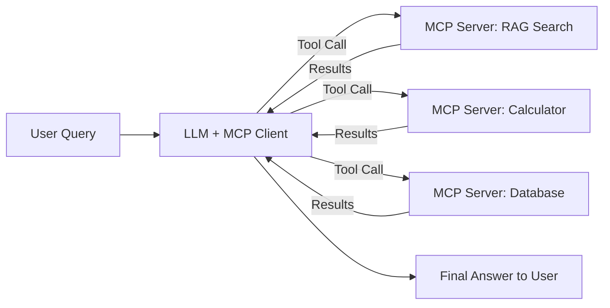

<WhatYouWillLearn>
- Define the Model Context Protocol (MCP) and its role in tool-use
- Build an MCP server that exposes your RAG pipeline as a tool
- Connect multiple tools (search, compute, database) via MCP
- Handle tool execution safely with validation and sandboxing
- Debug common tool-calling failures
</WhatYouWillLearn>

<WhyThisMatters>
MCP (Model Context Protocol) is becoming the standard way to connect LLMs to external tools and data sources. It's the USB-C of AI tool integration — one protocol, many tools. Understanding MCP lets you build AI assistants that do more than answer questions: they can search databases, run calculations, file tickets, and call APIs. This is the skill that turns a RAG chatbot into a useful work assistant.
</WhyThisMatters>

<Diagram>

</Diagram>

<Body>
## What is MCP?

The Model Context Protocol (MCP) is an open standard for connecting LLMs to tools and data sources. It defines a JSON-RPC-based protocol where:

- **MCP Servers** expose tools (functions the LLM can call), resources (data the LLM can read), and prompts (templates)
- **MCP Clients** (like Claude Desktop, VS Code, or your own app) discover available tools and route LLM tool calls to the right server
- **Transports** carry messages between client and server (stdio for local, HTTP/SSE for remote)

The key benefit: you write your tool once as an MCP server, and it works with any MCP-compatible client. No custom integration per LLM provider.

## Building an MCP server

Let's build a server that exposes a RAG search tool. We'll use the official Python SDK.

```python
# rag_server.py
from mcp.server import Server
from mcp.server.stdio import stdio_server
from mcp.types import Tool, TextContent
import json

# Your existing RAG retriever
from retrieval import Retriever

app = Server("rag-search")
retriever = Retriever(index_path="./faiss_index", metadata_path="./metadata.json")

@app.list_tools()
async def list_tools() -> list[Tool]:
    return [
        Tool(
            name="search_knowledge_base",
            description="Search the knowledge base for information relevant to a query. Returns the top matching passages with source citations.",
            inputSchema={
                "type": "object",
                "properties": {
                    "query": {
                        "type": "string",
                        "description": "The search query"
                    },
                    "top_k": {
                        "type": "integer",
                        "description": "Number of results to return (default 5)",
                        "default": 5
                    }
                },
                "required": ["query"]
            }
        )
    ]

@app.call_tool()
async def call_tool(name: str, arguments: dict) -> list[TextContent]:
    if name == "search_knowledge_base":
        query = arguments["query"]
        top_k = arguments.get("top_k", 5)
        
        results = retriever.search(query, top_k=top_k)
        
        formatted = []
        for i, r in enumerate(results):
            formatted.append(f"[{i+1}] (score: {r.score:.3f}) {r.text}\n    Source: {r.source}")
        
        return [TextContent(type="text", text="\n\n".join(formatted))]
    
    raise ValueError(f"Unknown tool: {name}")

async def main():
    async with stdio_server() as (read, write):
        await app.run(read, write, app.create_initialization_options())

if __name__ == "__main__":
    import asyncio
    asyncio.run(main())
```

## Registering the server

For Claude Desktop, add your server to the config file:

```json
{
  "mcpServers": {
    "rag-search": {
      "command": "python",
      "args": ["rag_server.py"],
      "cwd": "/path/to/your/project"
    }
  }
}
```

For a custom client, use the MCP client SDK to discover and call tools:

```python
from mcp.client import ClientSession
from mcp.client.stdio import stdio_client

async def use_rag_tool():
    async with stdio_client("python", ["rag_server.py"]) as (read, write):
        async with ClientSession(read, write) as session:
            await session.initialize()
            
            # Discover tools
            tools = await session.list_tools()
            print(f"Available tools: {[t.name for t in tools.tools]}")
            
            # Call the tool
            result = await session.call_tool(
                "search_knowledge_base",
                {"query": "What is the refund policy?", "top_k": 3}
            )
            print(result.content[0].text)
```

## Adding more tools

A useful RAG assistant needs more than search. Here's how to add a calculator and database lookup:

```python
@app.list_tools()
async def list_tools() -> list[Tool]:
    return [
        Tool(
            name="search_knowledge_base",
            description="Search the knowledge base for relevant documents",
            inputSchema={...}  # as above
        ),
        Tool(
            name="calculate",
            description="Evaluate a mathematical expression. Use for any arithmetic the user asks about.",
            inputSchema={
                "type": "object",
                "properties": {
                    "expression": {
                        "type": "string",
                        "description": "A Python math expression, e.g. '(500 * 1.08) - 200'"
                    }
                },
                "required": ["expression"]
            }
        ),
        Tool(
            name="lookup_customer",
            description="Look up customer details by email address",
            inputSchema={
                "type": "object",
                "properties": {
                    "email": {
                        "type": "string",
                        "description": "Customer email address"
                    }
                },
                "required": ["email"]
            }
        ),
    ]

@app.call_tool()
async def call_tool(name: str, arguments: dict) -> list[TextContent]:
    if name == "search_knowledge_base":
        return await handle_search(arguments)
    elif name == "calculate":
        return await handle_calculate(arguments)
    elif name == "lookup_customer":
        return await handle_customer_lookup(arguments)
    raise ValueError(f"Unknown tool: {name}")
```

## Safety: Validating tool calls

Never trust the LLM's tool arguments blindly. Validate and sandbox:

```python
import ast

async def handle_calculate(arguments: dict) -> list[TextContent]:
    expr = arguments["expression"]
    
    # Validate: only allow safe math operations
    allowed_nodes = {
        ast.Expression, ast.BinOp, ast.UnaryOp, ast.Num, ast.Constant,
        ast.Add, ast.Sub, ast.Mult, ast.Div, ast.Pow, ast.USub,
    }
    
    try:
        tree = ast.parse(expr, mode="eval")
        for node in ast.walk(tree):
            if type(node) not in allowed_nodes:
                return [TextContent(
                    type="text",
                    text=f"Error: Expression contains disallowed operation: {type(node).__name__}"
                )]
        
        result = eval(compile(tree, "<calc>", "eval"))
        return [TextContent(type="text", text=f"Result: {result}")]
    except Exception as e:
        return [TextContent(type="text", text=f"Error evaluating expression: {str(e)}")]

async def handle_customer_lookup(arguments: dict) -> list[TextContent]:
    email = arguments["email"]
    
    # Validate email format
    if "@" not in email or "." not in email:
        return [TextContent(type="text", text="Error: Invalid email format")]
    
    # Use parameterized queries — never interpolate user input into SQL
    customer = db.execute(
        "SELECT name, plan, status FROM customers WHERE email = ?",
        (email,)
    ).fetchone()
    
    if customer:
        return [TextContent(type="text", text=json.dumps(dict(customer)))]
    return [TextContent(type="text", text="No customer found with that email")]
```

## Tool descriptions matter

The LLM decides which tool to call based on the `description` field. Bad descriptions lead to wrong tool selection.

**Bad**: `"description": "Search stuff"`
**Good**: `"description": "Search the knowledge base for information relevant to a query. Returns the top matching passages with source citations. Use this when the user asks a question that might be answered by our documentation."`

Include:
- What the tool does
- What it returns
- When to use it (and when not to)

## Debugging common failures

### Tool not being called
- Check the description — the LLM might not understand when to use it
- Check the input schema — required fields must be clearly described
- Test with an explicit prompt: "Use the search_knowledge_base tool to find..."

### Wrong arguments
- Add stricter validation in your tool handler
- Make parameter descriptions more specific
- Add examples in the description: `"e.g., 'annual plan refund policy'"`

### Tool errors not surfacing
- Always return errors as TextContent, not exceptions
- The LLM can't debug a Python traceback — return a user-friendly error message
- Log the full error server-side for your debugging
</Body>

<Code>
```python
# Minimal MCP tool definition and validation example
import json
import ast

def validate_tool_call(name: str, arguments: dict, tool_schemas: dict) -> dict:
    """Validate tool arguments against the schema before execution."""
    if name not in tool_schemas:
        return {"valid": False, "error": f"Unknown tool: {name}"}
    
    schema = tool_schemas[name]
    required = schema.get("required", [])
    properties = schema.get("properties", {})
    
    # Check required fields
    for field in required:
        if field not in arguments:
            return {"valid": False, "error": f"Missing required field: {field}"}
    
    # Check types
    for key, value in arguments.items():
        if key in properties:
            expected_type = properties[key].get("type")
            actual_type = type(value).__name__
            type_map = {"string": "str", "integer": "int", "number": "float", "boolean": "bool"}
            if expected_type and type_map.get(expected_type) != actual_type:
                return {"valid": False, 
                        "error": f"Field '{key}' expected {expected_type}, got {actual_type}"}
    
    return {"valid": True}

# Test
schemas = {
    "search_knowledge_base": {
        "properties": {
            "query": {"type": "string"},
            "top_k": {"type": "integer"},
        },
        "required": ["query"],
    }
}

print(validate_tool_call("search_knowledge_base", {"query": "refund"}, schemas))
print(validate_tool_call("search_knowledge_base", {}, schemas))
print(validate_tool_call("unknown_tool", {"x": 1}, schemas))
```
</Code>

<TryItYourself>
1. Install the MCP Python SDK: `pip install mcp`
2. Create a simple MCP server with one tool (start with the calculator — it needs no external dependencies)
3. Test it using the MCP inspector: `npx @modelcontextprotocol/inspector python your_server.py`
4. Add a second tool (knowledge base search) and verify both appear in the tool list
5. Intentionally send bad arguments and confirm your validation catches them
</TryItYourself>

<CompletionChecklist>
- [ ] Built an MCP server with at least one tool
- [ ] Tested tool discovery and invocation
- [ ] Added input validation for tool arguments
- [ ] Wrote clear tool descriptions that help the LLM pick the right tool
- [ ] Can explain the MCP architecture (server, client, transport)
</CompletionChecklist>

<CommonMistakes>
- **Vague tool descriptions** — the LLM uses descriptions to decide which tool to call; be specific
- **No input validation** — the LLM might pass invalid arguments; always validate before executing
- **Using `eval()` without sandboxing** — for calculator tools, parse the AST and whitelist safe operations
- **SQL injection via tool arguments** — always use parameterized queries, never string interpolation
- **Swallowing errors silently** — return errors as tool output so the LLM can try a different approach
</CommonMistakes>

<DebuggingChecklist>
- [ ] Does `list_tools()` return all expected tools?
- [ ] Are tool descriptions specific enough for the LLM to choose correctly?
- [ ] Do all required schema fields have clear descriptions?
- [ ] Does the server handle invalid arguments gracefully (return error, not crash)?
- [ ] Are database queries parameterized?
- [ ] Is the calculator sandboxed against arbitrary code execution?
</DebuggingChecklist>

<MiniQuiz>
**Q: Your LLM assistant has access to both a "search_docs" tool and a "search_web" tool. Users report it always calls "search_web" even for questions about internal docs. What's the most likely cause?**

- A) The LLM prefers web search
- B) The tool descriptions don't clearly explain when to use each tool ✅
- C) MCP servers can only have one search tool
- D) The web search tool is listed first
</MiniQuiz>

<InterviewExplanation>
"MCP is a protocol for connecting LLMs to tools via a standard JSON-RPC interface. I'd build an MCP server that exposes tools like knowledge base search, calculation, and database lookup. The LLM client discovers available tools at startup and decides which to call based on the tool descriptions and input schema. The critical engineering concerns are: tool descriptions must be specific enough for correct selection, all tool inputs must be validated and sandboxed, and errors should be returned as tool output so the LLM can recover. MCP's value is interoperability — write the tool once, use it with Claude, GPT, or any MCP-compatible client."
</InterviewExplanation>

<ResumeBullet>
Built MCP-compliant tool servers exposing RAG search, database lookup, and computation tools to LLM clients, with input validation and sandboxed execution for production safety
</ResumeBullet>
