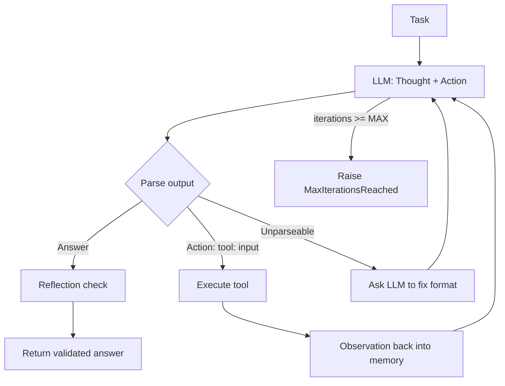

<WhatYouWillLearn>
- Explain the ReAct loop: Thought → Action → PAUSE → Observation → Answer
- Build a controller that prompts, parses, executes a tool, and feeds the result back
- Parse structured LLM output safely and recover from format errors
- Enforce a max-iterations cap so an agent can never loop forever
</WhatYouWillLearn>

<WhyThisMatters>
"Agent" is the most over-used word in AI, and most interviewers will ask you to actually describe the loop. The ReAct pattern is the canonical answer: a model that reasons, takes an action, observes the result, and repeats until it can answer. Build it once from scratch and you'll understand every agent framework you touch afterward.
</WhyThisMatters>

<Diagram>

</Diagram>

<Body>
## The loop in one breath

ReAct = **Reason + Act**. The model runs in a loop:

1. **Thought** — it reasons about what to do next
2. **Action** — it calls one tool with an input, then emits `PAUSE`
3. **Observation** — your code runs the tool and feeds the result back as a new message
4. Repeat until the model emits `Answer:`

The LLM never executes anything itself. It *requests* an action; your controller executes it and returns the observation. That separation is the whole trick.

## The system prompt teaches the format

You instruct the model to output strictly structured turns and you give it the list of available tools. A short worked example in the prompt dramatically improves format compliance.

## Parsing is where agents break

The model emits free text; you must extract `Thought`, `Action: <tool>: <input>`, or `Answer:`. Use anchored regex. Crucially: **if there's an `Answer:`, it wins** — stop the loop. If you can't parse anything, don't crash — tell the model it broke format and let it retry.

## Two safety rails

- **Max iterations** — every loop must have a hard cap, or a confused model burns your budget forever.
- **Feed observations into memory** — the agent must *remember* what tools returned, or it repeats the same action.
</Body>

<Code>
```python
import re

class AgentController:
    def __init__(self, tools, llm, memory, max_iterations: int = 8):
        self.tools, self.llm, self.memory = tools, llm, memory
        self.max_iterations = max_iterations
        self.system_prompt = (
            "You run in a loop of Thought, Action, PAUSE, Observation.\n"
            "Use 'Action: <tool>: <input>' then 'PAUSE'. When done, 'Answer: <final>'.\n"
            f"Available tools:\n{tools.get_tools_prompt_description()}"
        )

    def _parse(self, text: str):
        thought = re.search(r"Thought:\s*(.*?)(?=Action:|Answer:|$)", text, re.DOTALL)
        action = re.search(r"Action:\s*([\w-]+):\s*(.*?)(?=PAUSE|$)", text, re.DOTALL)
        answer = re.search(r"Answer:\s*(.*)", text, re.DOTALL)
        if answer:                                   # answer wins
            return None, answer.group(1).strip()
        if action:
            return (action.group(1).strip(), action.group(2).strip()), None
        return None, None

    def run(self, task: str) -> str:
        self.memory.clear()
        self.memory.add_message("user", task)
        for _ in range(self.max_iterations):
            response = self.llm.generate(self.system_prompt, self.memory.get_messages())
            self.memory.add_message("assistant", response)
            act, answer = self._parse(response)
            if answer:
                return answer
            if act:
                name, arg = act
                obs = self.tools.execute(name, arg)
                self.memory.add_message("user", f"Observation: {obs}")
            else:
                self.memory.add_message("user", "System: bad format. Use Action/PAUSE or Answer.")
        raise RuntimeError("MaxIterationsReached: no answer within the loop limit")
```
</Code>

<TryItYourself>
1. Implement a `ToolRegistry` (next lesson) with a `search_web` and a `calculator` tool
2. Wire the controller above and run a task that needs one tool call
3. Run a task that needs *two* sequential tool calls and confirm observations chain
4. Force a malformed response and verify the controller asks the model to fix its format
5. Set `max_iterations=2` on a hard task and confirm it raises instead of looping forever
</TryItYourself>

<CommonMistakes>
- **No max-iterations cap** — a confused agent loops until your budget is gone
- **Not feeding observations back into memory** — the agent forgets and repeats the same action
- **Treating an `Answer:` as just another action** — answer must short-circuit the loop
- **Crashing on parse failure** — recover by prompting the model to fix its format
- **Letting the LLM "execute" tools** — the model only *requests*; your code executes and returns the observation
- **Vague tool descriptions** — the model can't choose a tool it doesn't understand
</CommonMistakes>

<DebuggingChecklist>
- [ ] Does the loop terminate on `Answer:` immediately?
- [ ] Are observations added to memory before the next LLM call?
- [ ] Is there a hard iteration cap that raises a clear error?
- [ ] Does an unparseable response trigger a format-repair message, not a crash?
- [ ] Does the system prompt list every tool with a usable description?
- [ ] Are tool errors caught and returned as observations (so the agent can react)?
</DebuggingChecklist>

<MiniQuiz>
**Q: In a ReAct loop, who actually executes the tool the model "calls"?**

- A) The LLM executes it internally
- B) Your controller executes it and feeds the result back as an Observation ✅
- C) The user runs it manually
- D) The tool calls the LLM
</MiniQuiz>

<InterviewExplanation>
"ReAct is Reason plus Act. The model emits a Thought, then an Action — a tool name and input — and pauses. My controller, not the model, executes the tool and feeds the result back as an Observation. The model loops until it emits an Answer, which short-circuits the loop. Two rails keep it safe: a hard max-iterations cap so a confused agent can't burn budget forever, and writing every observation into memory so it doesn't repeat itself. Parsing is where agents break, so I anchor the regex, let Answer win, and on a parse failure I prompt the model to fix its format rather than crashing."
</InterviewExplanation>

<ResumeBullet>
Implemented a ReAct agent controller from scratch — structured Thought/Action/Observation parsing, tool execution loop, format-error recovery, and a max-iteration safety cap — without relying on an agent framework
</ResumeBullet>

<CompletionChecklist>
- [ ] Built a controller that loops Thought → Action → Observation → Answer
- [ ] Chained at least two tool calls on one task
- [ ] Handled a malformed response with format repair
- [ ] Enforced a max-iterations cap that raises cleanly
- [ ] Can explain who executes tools and why that separation matters
</CompletionChecklist>
