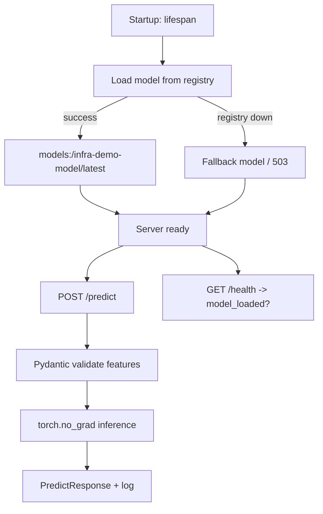

<WhatYouWillLearn>
- Serve a registered model behind a FastAPI inference endpoint
- Load the model once at startup (lifespan) to avoid cold starts on every request
- Validate request/response shapes with Pydantic
- Add a health check and structured logging for ops
- Build a graceful fallback when the registry is unavailable
</WhatYouWillLearn>

<WhyThisMatters>
This is the lesson where a model stops being a notebook artifact and becomes a service. Loading models correctly (once, at startup), validating payloads, exposing health, and logging predictions are the difference between an inference server that survives production traffic and one that falls over on the first cold start. It's the most portfolio-credible thing in this track.
</WhyThisMatters>

<Diagram>

</Diagram>

<Body>
## Load the model once, at startup

The cardinal sin of model serving is loading the model **inside** the request handler — every request pays the load cost and you melt under traffic. Load it once in a **lifespan** hook before the server accepts traffic, into a process-global, and reuse it for every request.

## Pull from the registry, not a file path

Serving pulls the model by name/version from the registry (`models:/infra-demo-model/latest`), so deploying a new model is a registry promotion, not a code change. Always have a **fallback** for when the registry is unreachable, so the service degrades instead of refusing to start.

## Validate the contract with Pydantic

Define `PredictRequest` and `PredictResponse` models. FastAPI then rejects malformed payloads with a 422 automatically, and your response shape is guaranteed. Check semantic constraints (e.g. exactly 10 features) explicitly and return a 400.

## Health checks and logging

A `/health` endpoint that reports whether the model loaded lets your orchestrator know when to route traffic. Structured logs (one event per prediction, with latency) feed monitoring and offline drift analysis.

## Inference hygiene

Wrap inference in `torch.no_grad()` (no gradients at serving time), convert payloads to tensors explicitly, and catch errors into a clean 500 rather than leaking a stack trace.
</Body>

<Code>
```python
from contextlib import asynccontextmanager
from fastapi import FastAPI, HTTPException
from pydantic import BaseModel
import mlflow.pytorch, torch

model = None  # process-global, loaded once

class PredictRequest(BaseModel):
    features: list[float]

class PredictResponse(BaseModel):
    prediction: float
    probability: float
    model_version: str

@asynccontextmanager
async def lifespan(app: FastAPI):
    global model
    try:                                          # pull from registry
        model = mlflow.pytorch.load_model("models:/infra-demo-model/latest")
    except Exception:                             # graceful fallback
        from src.model import SimpleNet
        model = SimpleNet(input_dim=10)
    model.eval()
    yield                                         # server now accepts traffic

app = FastAPI(lifespan=lifespan, title="Inference Server")

@app.post("/predict", response_model=PredictResponse)
async def predict(req: PredictRequest):
    if len(req.features) != 10:
        raise HTTPException(400, "Expected exactly 10 features.")
    try:
        x = torch.tensor(req.features, dtype=torch.float32).unsqueeze(0)
        with torch.no_grad():
            prob = model(x).item()
        return PredictResponse(prediction=1.0 if prob >= 0.5 else 0.0,
                               probability=prob, model_version="latest")
    except Exception:
        raise HTTPException(500, "Internal inference failure")

@app.get("/health")
async def health():
    return {"status": "healthy", "model_loaded": model is not None}
```
</Code>

<TryItYourself>
1. Run the server (`uvicorn serve:app`) and hit `/health`
2. POST valid features to `/predict`; confirm the response shape
3. POST 9 features and confirm a 400; POST a string and confirm a 422 from Pydantic
4. Kill the registry path and confirm the fallback model still serves
5. Add per-request latency logging and watch it under a few concurrent requests
</TryItYourself>

<CommonMistakes>
- **Loading the model inside the handler** — every request pays the load cost; load once in lifespan
- **No fallback when the registry is down** — the service won't even start
- **Skipping Pydantic** — malformed payloads crash inference instead of returning 422
- **Forgetting `torch.no_grad()`** — wastes memory/compute building gradients you don't need
- **Leaking stack traces** — catch into a clean 500
- **No `/health`** — the orchestrator can't tell when to send traffic
</CommonMistakes>

<DebuggingChecklist>
- [ ] Is the model a process-global loaded exactly once at startup?
- [ ] Does `/health` reflect the real load state?
- [ ] Does an invalid payload return 422 (Pydantic) or 400 (semantic), not 500?
- [ ] Is inference wrapped in `torch.no_grad()`?
- [ ] Does the registry-down path fall back instead of crashing?
- [ ] Is each prediction logged with latency for monitoring?
</DebuggingChecklist>

<MiniQuiz>
**Q: Why load the model in a FastAPI lifespan hook instead of inside the `/predict` handler?**

- A) Lifespan hooks are required by Pydantic
- B) So the model loads once before traffic, avoiding a cold-start load on every request ✅
- C) It makes inference more accurate
- D) Handlers can't import torch
</MiniQuiz>

<InterviewExplanation>
"Serving is where a model becomes a service. The cardinal rule is to load it once, in a FastAPI lifespan hook, into a process-global before the server accepts traffic — never inside the request handler, or every request pays the load cost. I pull the model by name and version from the registry so a new deploy is a promotion, not a code change, and I always include a fallback for when the registry is unreachable so the service degrades instead of failing to start. Pydantic validates the request and response contract, a /health endpoint reports load state to the orchestrator, and I log each prediction with latency for monitoring and offline drift analysis."
</InterviewExplanation>

<ResumeBullet>
Built a production FastAPI inference server with registry-backed model loading at startup, Pydantic request validation, health checks, structured per-prediction logging, and a graceful fallback when the model registry is unavailable
</ResumeBullet>

<CompletionChecklist>
- [ ] Served a model behind a FastAPI `/predict` endpoint
- [ ] Loaded the model once via a lifespan hook
- [ ] Validated payloads with Pydantic (422/400 paths)
- [ ] Added `/health` and per-prediction logging
- [ ] Implemented a registry-down fallback
</CompletionChecklist>
