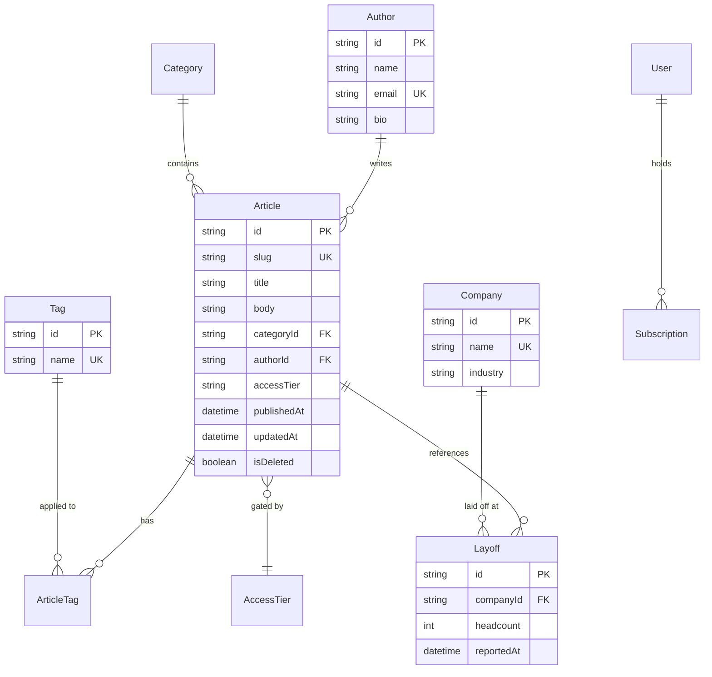

<WhatYouWillLearn>
- Translate product requirements into a normalized relational schema
- Make deliberate decisions about ID strategy, timestamps, soft deletes, and indexing
- Model content hierarchies: categories, tags, authors, and access tiers
- Write a complete Prisma schema for a content site and defend every design choice
</WhatYouWillLearn>

<WhyThisMatters>
Schema design is the most consequential technical decision in a full-stack app. A bad schema means N+1 queries, painful migrations, and features that become impossible to build. Senior engineers evaluate juniors on schema quality because it reveals whether you think about data before you think about UI.
</WhyThisMatters>

<Diagram>

</Diagram>

<Body>
## Starting from requirements, not tables

Before opening `schema.prisma`, write down what your product needs to do:

1. Authors write articles organized by category
2. Articles can have multiple tags
3. Some articles are free, some require a paid subscription
4. The site tracks layoff events linked to companies
5. Articles can reference specific layoff events
6. Deleted content should be recoverable (soft delete)
7. URLs use slugs, not numeric IDs

Each requirement maps to a schema decision. Let's work through them.

## Decision 1: ID strategy

You have three options:
- **Auto-increment integers** (`@default(autoincrement())`) — simple, but leak information (user #47 knows there are at least 46 others) and cause conflicts when merging data from multiple sources
- **CUIDs** (`@default(cuid())`) — collision-resistant, URL-friendly, sortable by creation time
- **UUIDs** (`@default(uuid())`) — universally unique, but long and not sortable

For a content site, **CUIDs** are the best default. They're shorter than UUIDs, sortable, and don't leak counts.

## Decision 2: Slugs as unique identifiers

Articles need human-readable URLs (`/articles/big-tech-layoffs-2026`). The `slug` field gets a `@unique` constraint:

```prisma
model Article {
  id   String @id @default(cuid())
  slug String @unique   // Used in URLs
}
```

Never use the slug as the primary key. Slugs can change (title edits); primary keys should not.

## Decision 3: Timestamps and soft deletes

Every mutable model should have `createdAt` and `updatedAt`. Content sites also need soft deletes — accidental deletions should be reversible:

```prisma
model Article {
  createdAt   DateTime  @default(now())
  updatedAt   DateTime  @updatedAt
  isDeleted   Boolean   @default(false)
  deletedAt   DateTime?
}
```

Every query must filter by `isDeleted: false`. This is a tradeoff — it adds complexity to every query but prevents data loss.

## Decision 4: Content access tiers

Instead of a boolean `isPremium`, use an enum. This lets you add tiers later without a migration:

```prisma
enum AccessTier {
  FREE
  BASIC
  PREMIUM
}

model Article {
  accessTier AccessTier @default(FREE)
}
```

## Decision 5: Tags — implicit vs explicit join table

Prisma supports implicit many-to-many (just put `Tag[]` on Article and `Article[]` on Tag). But if you ever want metadata on the relationship (like "who tagged this?" or "when was it tagged?"), you need an explicit join table:

```prisma
model ArticleTag {
  id        String   @id @default(cuid())
  article   Article  @relation(fields: [articleId], references: [id])
  articleId String
  tag       Tag      @relation(fields: [tagId], references: [id])
  tagId     String
  addedAt   DateTime @default(now())

  @@unique([articleId, tagId])  // Prevent duplicate tags
}
```

The `@@unique` compound constraint ensures the same tag can't be applied to the same article twice.

## Decision 6: Indexing for query performance

Think about your most common queries and add indexes:

```prisma
model Article {
  // ...
  @@index([publishedAt])     // Listing pages sort by date
  @@index([categoryId])      // Category filter pages
  @@index([authorId])        // Author profile pages
  @@index([accessTier])      // Paywall checks
}
```

Without indexes, these queries do full table scans. With 10,000 articles, that's the difference between 2ms and 200ms.

## The complete schema

Putting it all together:

```prisma
datasource db {
  provider = "postgresql"
  url      = env("DATABASE_URL")
}

generator client {
  provider = "prisma-client-js"
}

enum AccessTier {
  FREE
  BASIC
  PREMIUM
}

model Author {
  id        String    @id @default(cuid())
  name      String
  email     String    @unique
  bio       String?
  avatarUrl String?
  articles  Article[]
  createdAt DateTime  @default(now())
}

model Category {
  id       String    @id @default(cuid())
  name     String    @unique
  slug     String    @unique
  articles Article[]
}

model Article {
  id          String      @id @default(cuid())
  slug        String      @unique
  title       String
  body        String
  excerpt     String?
  accessTier  AccessTier  @default(FREE)
  author      Author      @relation(fields: [authorId], references: [id])
  authorId    String
  category    Category    @relation(fields: [categoryId], references: [id])
  categoryId  String
  tags        ArticleTag[]
  layoffs     Layoff[]
  publishedAt DateTime    @default(now())
  updatedAt   DateTime    @updatedAt
  isDeleted   Boolean     @default(false)
  deletedAt   DateTime?

  @@index([publishedAt])
  @@index([categoryId])
  @@index([authorId])
  @@index([accessTier])
}

model Tag {
  id       String       @id @default(cuid())
  name     String       @unique
  articles ArticleTag[]
}

model ArticleTag {
  id        String   @id @default(cuid())
  article   Article  @relation(fields: [articleId], references: [id])
  articleId String
  tag       Tag      @relation(fields: [tagId], references: [id])
  tagId     String
  addedAt   DateTime @default(now())

  @@unique([articleId, tagId])
}

model Company {
  id       String   @id @default(cuid())
  name     String   @unique
  industry String?
  layoffs  Layoff[]
}

model Layoff {
  id         String   @id @default(cuid())
  company    Company  @relation(fields: [companyId], references: [id])
  companyId  String
  headcount  Int
  percentage Float?
  source     String
  reportedAt DateTime
  article    Article? @relation(fields: [articleId], references: [id])
  articleId  String?

  @@index([companyId])
  @@index([reportedAt])
}
```
</Body>

<Code>
```prisma
// Key patterns to memorize for interviews:

// 1. Enum for extensible categories
enum AccessTier {
  FREE
  BASIC
  PREMIUM
}

// 2. Explicit join table with compound unique
model ArticleTag {
  id        String   @id @default(cuid())
  article   Article  @relation(fields: [articleId], references: [id])
  articleId String
  tag       Tag      @relation(fields: [tagId], references: [id])
  tagId     String

  @@unique([articleId, tagId])
}

// 3. Soft delete pattern
model Article {
  isDeleted Boolean   @default(false)
  deletedAt DateTime?
  // Every query: where: { isDeleted: false }
}

// 4. Performance indexes on filter/sort columns
model Article {
  @@index([publishedAt])
  @@index([categoryId])
}
```
</Code>

<TryItYourself>
1. Take a product you use daily (Twitter, Reddit, a blog) and write down 5 product requirements
2. Translate each requirement into a Prisma model with fields and relations
3. Decide: CUID vs UUID vs autoincrement — write a sentence justifying your choice
4. Add soft deletes and timestamps to your mutable models
5. Identify the 3 most common queries and add `@@index` for each
6. Run `npx prisma migrate dev` to validate your schema compiles
7. Have a peer try to break your schema — can they create invalid data?
</TryItYourself>

<CommonMistakes>
- **Designing the schema after the UI** — schema should come first; it's harder to change later
- **Using slugs as primary keys** — slugs change when titles are edited; use a separate stable `id`
- **Skipping indexes** — works fine with 100 rows, falls apart at 10,000+
- **Boolean `isPremium` instead of an enum** — you'll inevitably need more than two tiers
- **Implicit many-to-many when you need metadata** — switching from implicit to explicit join table later requires a migration that rewrites the join table
</CommonMistakes>

<DebuggingChecklist>
- [ ] Does `npx prisma validate` pass without errors?
- [ ] Are all foreign key fields (`authorId`, `companyId`) defined as scalar fields alongside the relation?
- [ ] Does every model with a `@relation` have the corresponding back-relation on the other model?
- [ ] Are `@@unique` constraints on join tables to prevent duplicate relationships?
- [ ] Do your indexes match your most common `WHERE` and `ORDER BY` clauses?
- [ ] Are optional fields marked with `?` (e.g., `deletedAt DateTime?`)?
</DebuggingChecklist>

<MiniQuiz>
**Q: You have an Article model and a Tag model. You want to record who added each tag and when. Which approach is correct?**

- A) Implicit many-to-many with `Tag[]` on Article
- B) Explicit join table `ArticleTag` with `addedAt` and `addedBy` fields ✅
- C) Add a `taggedArticles` JSON field on the Tag model
- D) Store tag IDs as a comma-separated string on Article
</MiniQuiz>

<InterviewExplanation>
"When designing a content schema, I start with product requirements, not tables. For a content site, I'd use CUIDs for IDs — they're collision-resistant and sortable. Slugs get a unique constraint but are never the primary key because they can change. I use enums for access tiers instead of booleans for extensibility. For many-to-many relations where I need metadata, I use explicit join tables with compound unique constraints. Every mutable model gets timestamps and soft deletes. Finally, I add indexes on columns used in WHERE and ORDER BY clauses — publishedAt for listing pages, categoryId for filters."
</InterviewExplanation>

<ResumeBullet>
Designed a normalized PostgreSQL schema for a content management system with soft deletes, enum-based access tiers, explicit join tables, and performance indexes, using Prisma ORM with type-safe migrations
</ResumeBullet>

<CompletionChecklist>
- [ ] Wrote a schema with 5+ models and justified every design choice
- [ ] Used CUIDs, enums, soft deletes, and compound unique constraints
- [ ] Added indexes for the 3 most common query patterns
- [ ] Schema passes `npx prisma validate`
- [ ] Can explain each decision in interview format
</CompletionChecklist>
