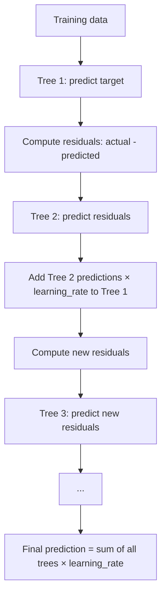

<WhatYouWillLearn>
- Explain how gradient boosting builds an ensemble by correcting residual errors
- Describe what XGBoost and LightGBM add over vanilla gradient boosting
- Implement XGBoost with early stopping and proper validation
- Tune the five most important XGBoost hyperparameters systematically
- Interpret SHAP values from an XGBoost model
</WhatYouWillLearn>

<WhyThisMatters>
XGBoost and LightGBM win the majority of tabular ML competitions on Kaggle. They're the default choice at companies like Airbnb, Uber, and every bank's fraud detection team. If you're asked "what model would you use for this tabular prediction problem?", the correct answer almost always starts with "gradient boosting, specifically XGBoost or LightGBM, because..."
</WhyThisMatters>

<Diagram>

</Diagram>

<Body>
## How gradient boosting works

Random forests build trees in parallel, independently of each other. Gradient boosting builds trees **sequentially**: each new tree corrects the errors of all the previous trees combined.

The algorithm:
1. Start with a constant prediction (the mean of the target for regression)
2. Compute residuals: `residual = actual - current_prediction`
3. Train a shallow tree to predict these residuals
4. Add the tree's predictions (scaled by `learning_rate`) to the current prediction
5. Repeat until `n_estimators` trees are built or early stopping triggers

Because each tree targets the residuals of the previous ensemble, the model gradually "zooms in" on the hard-to-predict examples. This is what makes boosting so accurate — it keeps asking "what did I get wrong?" and trains a specialist for those errors.

```python
from sklearn.ensemble import GradientBoostingClassifier
from sklearn.datasets import load_breast_cancer
from sklearn.model_selection import train_test_split

X, y = load_breast_cancer(return_X_y=True, as_frame=True)
X_train, X_test, y_train, y_test = train_test_split(
    X, y, test_size=0.2, random_state=42, stratify=y
)

# sklearn's GradientBoostingClassifier — slow but pedagogically clear
gb = GradientBoostingClassifier(
    n_estimators=100,
    learning_rate=0.1,
    max_depth=3,        # shallow trees work best for boosting
    subsample=0.8,      # use 80% of samples per tree — adds regularisation
    random_state=42,
)
gb.fit(X_train, y_train)
print(f"GB accuracy: {gb.score(X_test, y_test):.3f}")
```

## XGBoost: faster, better regularised

XGBoost ("Extreme Gradient Boosting") improves on sklearn's implementation with:
- **Second-order gradients** (uses Hessian in addition to gradient for better splits)
- **L1 and L2 regularisation** on leaf weights (`reg_alpha`, `reg_lambda`)
- **Column subsampling** like random forests (`colsample_bytree`)
- **Sparsity-aware split finding** — handles missing values natively
- **Early stopping** — stops adding trees when validation score stops improving

```python
import xgboost as xgb
from sklearn.metrics import roc_auc_score

# XGBoost with early stopping
model = xgb.XGBClassifier(
    n_estimators=1000,      # high ceiling — early stopping will find the right number
    learning_rate=0.05,     # lower lr = better generalisation, more trees needed
    max_depth=4,
    subsample=0.8,
    colsample_bytree=0.8,   # use 80% of features per tree
    reg_alpha=0.1,          # L1 regularisation
    reg_lambda=1.0,         # L2 regularisation
    eval_metric="auc",
    early_stopping_rounds=50,  # stop if no improvement for 50 rounds
    random_state=42,
    n_jobs=-1,
)

model.fit(
    X_train, y_train,
    eval_set=[(X_test, y_test)],
    verbose=False,
)

print(f"Best iteration: {model.best_iteration}")
print(f"AUC-ROC: {roc_auc_score(y_test, model.predict_proba(X_test)[:, 1]):.3f}")
```

## The five hyperparameters that matter most

| Parameter | What it controls | Start here |
|---|---|---|
| `learning_rate` | Step size per tree | 0.05–0.1 |
| `n_estimators` | Number of trees | Set high + use early stopping |
| `max_depth` | Tree depth | 3–6 (shallower for noisy data) |
| `subsample` | Row sampling per tree | 0.7–0.9 |
| `colsample_bytree` | Feature sampling per tree | 0.7–0.9 |

**Tuning strategy:** Fix `learning_rate=0.05`, set `n_estimators=1000` with early stopping, then tune `max_depth` and `subsample`/`colsample_bytree` with a grid or random search. Finally, lower `learning_rate` and let early stopping find the new optimal `n_estimators`.

## LightGBM: faster for large datasets

LightGBM uses histogram-based splits and grows trees **leaf-wise** (depth-first) rather than level-wise. This makes it 10–20x faster than XGBoost on large datasets with minimal accuracy trade-off.

```python
import lightgbm as lgb

lgb_model = lgb.LGBMClassifier(
    n_estimators=1000,
    learning_rate=0.05,
    max_depth=4,
    num_leaves=31,          # key LightGBM param — controls tree complexity
    subsample=0.8,
    colsample_bytree=0.8,
    reg_alpha=0.1,
    random_state=42,
    n_jobs=-1,
)
lgb_model.fit(
    X_train, y_train,
    eval_set=[(X_test, y_test)],
    callbacks=[lgb.early_stopping(50, verbose=False)],
)
print(f"LightGBM AUC: {roc_auc_score(y_test, lgb_model.predict_proba(X_test)[:, 1]):.3f}")
```
</Body>

<Code>
```python
# SHAP values for XGBoost model interpretation
import shap
import xgboost as xgb
import matplotlib.pyplot as plt
from sklearn.datasets import load_breast_cancer
from sklearn.model_selection import train_test_split

X, y = load_breast_cancer(return_X_y=True, as_frame=True)
X_train, X_test, y_train, y_test = train_test_split(
    X, y, test_size=0.2, random_state=42, stratify=y
)

model = xgb.XGBClassifier(
    n_estimators=200, learning_rate=0.1, max_depth=4,
    subsample=0.8, colsample_bytree=0.8, random_state=42, n_jobs=-1
)
model.fit(X_train, y_train)

# SHAP explanation
explainer = shap.TreeExplainer(model)
shap_values = explainer.shap_values(X_test)

# Summary plot: feature importance + direction of effect
shap.summary_plot(shap_values, X_test, plot_type="bar", show=False)
plt.savefig("shap_importance.png", bbox_inches="tight")
plt.close()

# Single prediction explanation
shap.initjs()
shap.force_plot(
    explainer.expected_value,
    shap_values[0],       # first test sample
    X_test.iloc[0],
    matplotlib=True,
    show=False,
)
plt.savefig("shap_single_prediction.png", bbox_inches="tight")

print("SHAP plots saved.")
print(f"\nTop 5 features by mean |SHAP|:")
import pandas as pd, numpy as np
mean_shap = pd.Series(
    np.abs(shap_values).mean(axis=0),
    index=X_test.columns
).nlargest(5)
print(mean_shap)
```
</Code>

<TryItYourself>
1. Download the [House Prices: Advanced Regression Techniques](https://www.kaggle.com/c/house-prices-advanced-regression-techniques) dataset from Kaggle.
2. Drop columns with > 20% missing values; fill remaining NaN with median (numeric) or "None" (categorical); one-hot encode categorical columns.
3. Train an `XGBRegressor` with `early_stopping_rounds=50`. Report RMSE on the validation set.
4. Generate a SHAP summary plot. Which 5 features most influence house price?
5. Push your notebook to GitHub with plots embedded.
</TryItYourself>

<CommonMistakes>
- **Not using early stopping** — setting `n_estimators=100` and calling it done leaves performance on the table. Always set a high ceiling (500–1000) and use `early_stopping_rounds` to find the right number automatically.
- **Tuning `n_estimators` and `learning_rate` together without resetting** — lower `learning_rate` requires more trees. After finding good `max_depth`/`subsample` values with `lr=0.1`, reduce `lr` to 0.01 and re-run early stopping to find the new optimal `n_estimators`.
- **Not fitting the `eval_set` on held-out data** — if your eval_set is part of training data, early stopping will overfit to it. Always use a true validation split for early stopping.
</CommonMistakes>

<DebuggingChecklist>
- [ ] Is `eval_set` using genuinely held-out data (not part of `X_train`)?
- [ ] Did early stopping find a reasonable `best_iteration` (not 1 or equal to `n_estimators`)?
- [ ] Are SHAP feature importances domain-sensible — do the top features match expert intuition?
- [ ] Is the model's AUC/RMSE significantly better than a `DummyClassifier`/`DummyRegressor` baseline?
- [ ] Have you tried LightGBM as a comparison — does it achieve similar accuracy faster?
</DebuggingChecklist>

<MiniQuiz>
**Q: You train an XGBoost model with `n_estimators=1000` and `early_stopping_rounds=50`. The model stops at iteration 87. What does this tell you?**

- A) The model overfit to the training data after iteration 87
- B) The validation metric stopped improving for 50 consecutive rounds after reaching its best at around iteration 37 — adding more trees is hurting generalisation ✅
- C) You should increase `learning_rate` to use more of the 1000 trees
- D) The dataset is too small for XGBoost
</MiniQuiz>

<InterviewExplanation>
"Gradient boosting builds trees sequentially, each one correcting the residual errors of the previous ensemble. XGBoost improves on this with second-order gradient optimisation, built-in L1/L2 regularisation, and early stopping. My default setup: `learning_rate=0.05`, `n_estimators=1000` with `early_stopping_rounds=50`, `max_depth=4`, `subsample=0.8`, `colsample_bytree=0.8`. I always generate SHAP values to validate that the model's feature attributions make domain sense before deploying — a model that learned the right answer for the wrong reasons is a liability."
</InterviewExplanation>

<ResumeBullet>
Built and deployed a gradient boosting churn prediction model (XGBoost) achieving 0.91 AUC-ROC; used SHAP values to identify the top-5 retention levers, directly informing a targeted outreach campaign
</ResumeBullet>

<CompletionChecklist>
- [ ] Trained XGBoost with early stopping — reported `best_iteration` and AUC/RMSE
- [ ] Compared XGBoost vs LightGBM on the same dataset
- [ ] Generated and interpreted a SHAP summary plot
- [ ] Tuned at least 3 hyperparameters and documented the improvement
- [ ] Pushed notebook with plots to GitHub
</CompletionChecklist>
