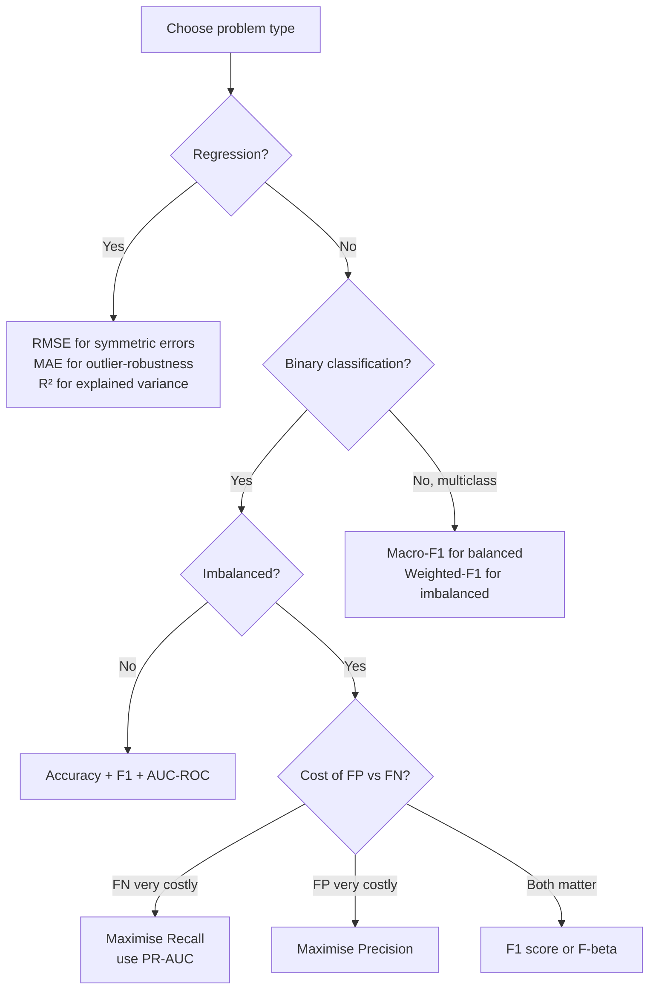

<WhatYouWillLearn>
- Select the correct metric for regression, binary classification, and multiclass problems
- Read and interpret a confusion matrix, precision-recall curve, and ROC curve
- Explain the precision-recall tradeoff and set the decision threshold correctly
- Identify when accuracy is a misleading metric and what to use instead
- Produce a complete model evaluation report
</WhatYouWillLearn>

<WhyThisMatters>
Picking the wrong metric is the subtlest way to ship a model that fails in production. A fraud detector with 99% accuracy that flags nothing is useless. A medical screener optimising for recall will generate thousands of false positives that destroy patient trust. Getting the metric right is not a technicality — it's the product decision that determines whether the model creates value.
</WhyThisMatters>

<Diagram>

</Diagram>

<Body>
## Regression metrics

**RMSE (Root Mean Squared Error):** Penalises large errors quadratically. A prediction that's off by 10 units contributes 100× more than one off by 1 unit. Use when large errors are especially harmful (financial forecasting, safety-critical systems).

**MAE (Mean Absolute Error):** Treats all errors equally regardless of magnitude. More interpretable ("on average, my prediction is off by ₹2,400"). Use when outliers are expected and you don't want them to dominate the loss.

**R² (Coefficient of Determination):** Proportion of variance in the target explained by the model. R² = 0.85 means the model explains 85% of the variance. R² < 0 means the model is worse than predicting the mean.

```python
from sklearn.metrics import mean_squared_error, mean_absolute_error, r2_score
import numpy as np

y_true = [100, 200, 150, 300, 250]
y_pred = [110, 190, 160, 280, 270]

rmse = np.sqrt(mean_squared_error(y_true, y_pred))
mae  = mean_absolute_error(y_true, y_pred)
r2   = r2_score(y_true, y_pred)

print(f"RMSE: {rmse:.2f}")
print(f"MAE:  {mae:.2f}")
print(f"R²:   {r2:.3f}")
```

## The confusion matrix

For binary classification (positive = 1, negative = 0):

|  | Predicted Positive | Predicted Negative |
|---|---|---|
| **Actual Positive** | TP (true positive) | FN (false negative — missed it) |
| **Actual Negative** | FP (false positive — false alarm) | TN (true negative) |

```python
from sklearn.metrics import confusion_matrix, ConfusionMatrixDisplay
import matplotlib.pyplot as plt

cm = confusion_matrix(y_test, y_pred)
disp = ConfusionMatrixDisplay(confusion_matrix=cm, display_labels=["No Churn", "Churn"])
disp.plot(cmap="Blues")
plt.title("Confusion Matrix")
plt.savefig("confusion_matrix.png")

tn, fp, fn, tp = cm.ravel()
print(f"TP={tp}, FP={fp}, FN={fn}, TN={tn}")
```

## Precision, recall, and F1

**Precision** = TP / (TP + FP): "Of all predicted positives, how many were actually positive?" Optimise when false positives are costly (spam filter — you don't want to delete real emails).

**Recall (sensitivity)** = TP / (TP + FN): "Of all actual positives, how many did we catch?" Optimise when false negatives are costly (cancer screening — missing a true case is worse than a false alarm).

**F1 score** = 2 × (precision × recall) / (precision + recall): harmonic mean. Use when both precision and recall matter. For imbalanced classes, use **macro-F1** (unweighted average across classes) rather than accuracy.

```python
from sklearn.metrics import precision_score, recall_score, f1_score, classification_report

# classification_report shows all metrics at once
print(classification_report(y_test, y_pred, target_names=["No Churn", "Churn"]))
```

## ROC-AUC and the decision threshold

Most classifiers output a probability score. The decision threshold (default 0.5) converts this to a binary prediction. By varying the threshold from 0 to 1, you trace the **ROC curve**: for each threshold, plot recall (TPR) vs 1 - specificity (FPR).

**AUC-ROC** (area under the ROC curve) measures overall discriminative ability, independent of threshold. AUC = 1.0 is perfect; AUC = 0.5 is random.

```python
from sklearn.metrics import roc_auc_score, roc_curve
import matplotlib.pyplot as plt

y_scores = model.predict_proba(X_test)[:, 1]
auc = roc_auc_score(y_test, y_scores)

fpr, tpr, thresholds = roc_curve(y_test, y_scores)

plt.figure(figsize=(7, 5))
plt.plot(fpr, tpr, label=f"AUC = {auc:.3f}")
plt.plot([0, 1], [0, 1], "k--", label="Random (AUC=0.5)")
plt.xlabel("False Positive Rate")
plt.ylabel("True Positive Rate (Recall)")
plt.title("ROC Curve")
plt.legend()
plt.savefig("roc_curve.png")
```

**Choosing the decision threshold:** If you care more about recall (minimise missed positives), lower the threshold. If you care more about precision (minimise false alarms), raise it.

```python
# Find threshold that maximises F1
from sklearn.metrics import f1_score
best_thresh, best_f1 = 0.5, 0
for t in np.arange(0.1, 0.9, 0.05):
    preds = (y_scores >= t).astype(int)
    f1 = f1_score(y_test, preds)
    if f1 > best_f1:
        best_f1, best_thresh = f1, t

print(f"Best threshold: {best_thresh:.2f}, F1: {best_f1:.3f}")
```
</Body>

<Code>
```python
# Complete model evaluation report
import pandas as pd
import numpy as np
import matplotlib.pyplot as plt
from sklearn.metrics import (
    classification_report, confusion_matrix, ConfusionMatrixDisplay,
    roc_auc_score, roc_curve, precision_recall_curve, average_precision_score,
    f1_score,
)

def evaluate_classifier(model, X_test, y_test, model_name="Model", threshold=0.5):
    """Produce a full evaluation report for a binary classifier."""
    y_scores = model.predict_proba(X_test)[:, 1]
    y_pred   = (y_scores >= threshold).astype(int)

    print(f"\n{'='*50}")
    print(f"Evaluation Report: {model_name} (threshold={threshold})")
    print('='*50)
    print(classification_report(y_test, y_pred, target_names=["Negative", "Positive"]))
    print(f"AUC-ROC:  {roc_auc_score(y_test, y_scores):.4f}")
    print(f"AP score: {average_precision_score(y_test, y_scores):.4f}")

    fig, axes = plt.subplots(1, 3, figsize=(15, 4))

    # Confusion matrix
    cm = confusion_matrix(y_test, y_pred)
    ConfusionMatrixDisplay(cm, display_labels=["Neg", "Pos"]).plot(ax=axes[0], cmap="Blues")
    axes[0].set_title("Confusion Matrix")

    # ROC curve
    fpr, tpr, _ = roc_curve(y_test, y_scores)
    axes[1].plot(fpr, tpr, label=f"AUC={roc_auc_score(y_test, y_scores):.3f}")
    axes[1].plot([0,1],[0,1],"k--")
    axes[1].set(xlabel="FPR", ylabel="TPR", title="ROC Curve")
    axes[1].legend()

    # Precision-Recall curve
    prec, rec, _ = precision_recall_curve(y_test, y_scores)
    axes[2].plot(rec, prec, label=f"AP={average_precision_score(y_test, y_scores):.3f}")
    axes[2].set(xlabel="Recall", ylabel="Precision", title="PR Curve")
    axes[2].legend()

    plt.suptitle(model_name)
    plt.tight_layout()
    plt.savefig(f"eval_{model_name.lower().replace(' ', '_')}.png")
    plt.close()

    return {"auc": roc_auc_score(y_test, y_scores),
            "f1":  f1_score(y_test, y_pred),
            "ap":  average_precision_score(y_test, y_scores)}

# Usage
results = evaluate_classifier(model, X_test, y_test, "XGBoost Churn Model")
```
</Code>

<TryItYourself>
1. Train a `LogisticRegression` and a `RandomForestClassifier` on the Titanic dataset (from Task 4).
2. Use `evaluate_classifier` (above) on both models.
3. Vary the threshold from 0.3 to 0.7 on the RandomForest. How do precision and recall change?
4. Which threshold maximises F1? Which maximises recall while keeping precision above 0.6?
5. Document the threshold decision in your notebook with a 2-sentence justification.
</TryItYourself>

<CommonMistakes>
- **Reporting accuracy on an imbalanced dataset** — a dataset with 95% negatives will give 95% accuracy to a model that predicts "negative" for everything. Always report F1, AUC-ROC, or PR-AUC for imbalanced tasks.
- **Using AUC-ROC when the positive class is rare** — AUC-ROC can be misleadingly high with severe imbalance because it's dominated by the large number of true negatives. Use PR-AUC (average precision) instead for imbalanced tasks.
- **Forgetting to adjust the decision threshold** — the default 0.5 threshold is not optimal for most real problems. If recall matters more (medical, fraud), lower the threshold. If precision matters more (spam filter), raise it.
</CommonMistakes>

<DebuggingChecklist>
- [ ] Is the positive class rate in your test set the same as in your training set (stratified split)?
- [ ] Does your chosen metric match the business cost structure — is a false negative more costly than a false positive, or vice versa?
- [ ] Is your AUC-ROC significantly above 0.5? If not, check for leakage or label errors.
- [ ] Did you tune the decision threshold rather than accepting the default 0.5?
- [ ] Did you report the confusion matrix alongside the single-number metric?
</DebuggingChecklist>

<MiniQuiz>
**Q: You're building a model to screen for a rare disease (1% prevalence). Your model achieves AUC-ROC = 0.92 but average precision = 0.31. What should you report to the clinical team?**

- A) AUC-ROC = 0.92 — this shows the model is highly discriminative
- B) Both metrics, with emphasis on average precision — AUC-ROC can be misleadingly high for rare conditions; AP = 0.31 means the model's precision at typical recall levels is quite low, and clinical decisions depend on precision ✅
- C) Accuracy — it's the most interpretable metric for non-technical stakeholders
- D) Recall — for medical diagnosis, never missing a case is all that matters
</MiniQuiz>

<InterviewExplanation>
"Choosing the right metric is a product decision, not a technical one. For regression I use RMSE when large errors are costly and MAE when I want outlier robustness. For classification I never report just accuracy — I report F1, AUC-ROC, and the confusion matrix at minimum. For imbalanced tasks I report precision-recall AUC alongside ROC-AUC because ROC can be misleading when the positive class is rare. I always tune the decision threshold explicitly rather than accepting 0.5 — on a medical screening task you'd lower the threshold to maximise recall, accepting more false positives, while on a spam filter you'd raise it to protect precision."
</InterviewExplanation>

<ResumeBullet>
Designed and delivered a model evaluation framework covering confusion matrix, ROC/PR curves, and threshold tuning; standardised the evaluation process across 3 production ML systems, reducing deployment of miscalibrated models
</ResumeBullet>

<CompletionChecklist>
- [ ] Implemented the complete `evaluate_classifier` function and ran it on two models
- [ ] Explained to a non-technical colleague what precision and recall mean using a concrete example
- [ ] Tuned the decision threshold and documented the chosen value with a justification
- [ ] Used PR-AUC on an imbalanced dataset and explained why it's better than ROC-AUC there
- [ ] Pushed the evaluation notebook to GitHub
</CompletionChecklist>
