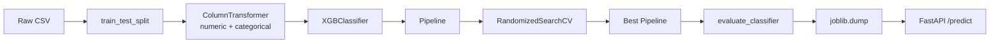

<WhatYouWillLearn>
- Build a full scikit-learn Pipeline from raw data to serialised model
- Use ColumnTransformer to apply different preprocessing to different feature types
- Run a RandomizedSearchCV hyperparameter search within the pipeline
- Save, load, and serve the trained pipeline as a FastAPI endpoint
- Produce a model card documenting the pipeline's behaviour and limitations
</WhatYouWillLearn>

<WhyThisMatters>
This is the capstone for the Classical ML phase. Everything you've learned — feature engineering, model selection, evaluation, hyperparameter tuning — comes together here in a single reproducible artifact. A serialised sklearn Pipeline is the standard deliverable for a tabular ML project: it encapsulates all preprocessing transformations so the exact same logic runs at inference time. If you can build and ship this, you can ship any tabular ML model.
</WhyThisMatters>

<Diagram>

</Diagram>

<Body>
## Project structure

```
ml_pipeline/
├── data/
│   └── churn.csv
├── pipeline.py        # build + train the pipeline
├── evaluate.py        # evaluation functions
├── serve.py           # FastAPI inference endpoint
├── model_card.md      # model documentation
└── requirements.txt
```

## Building the pipeline

```python
# pipeline.py
import pandas as pd
import numpy as np
import joblib
from sklearn.pipeline import Pipeline
from sklearn.compose import ColumnTransformer
from sklearn.preprocessing import StandardScaler, OneHotEncoder
from sklearn.impute import SimpleImputer
from sklearn.model_selection import train_test_split, RandomizedSearchCV
from sklearn.metrics import roc_auc_score, f1_score, classification_report
import xgboost as xgb

# --- Config ---
NUMERIC_FEATURES  = ["tenure_months", "monthly_charges", "total_charges"]
ORDINAL_FEATURES  = []
CATEGORY_FEATURES = ["contract_type", "internet_service", "payment_method"]
TARGET            = "churned"
MODEL_PATH        = "models/churn_pipeline.joblib"

# --- Load data ---
df = pd.read_csv("data/churn.csv")
df["total_charges"] = pd.to_numeric(df["total_charges"], errors="coerce")
X = df[NUMERIC_FEATURES + CATEGORY_FEATURES]
y = df[TARGET].map({"Yes": 1, "No": 0})

X_train, X_test, y_train, y_test = train_test_split(
    X, y, test_size=0.2, random_state=42, stratify=y
)

# --- Preprocessing ---
numeric_pipe = Pipeline([
    ("imputer", SimpleImputer(strategy="median")),
    ("scaler",  StandardScaler()),
])

category_pipe = Pipeline([
    ("imputer", SimpleImputer(strategy="most_frequent")),
    ("encoder", OneHotEncoder(handle_unknown="ignore", drop="first", sparse_output=False)),
])

preprocessor = ColumnTransformer([
    ("num", numeric_pipe,   NUMERIC_FEATURES),
    ("cat", category_pipe,  CATEGORY_FEATURES),
])

# --- Full pipeline ---
pipeline = Pipeline([
    ("preprocessor", preprocessor),
    ("model", xgb.XGBClassifier(
        eval_metric="logloss",
        random_state=42,
        n_jobs=-1,
    )),
])

# --- Hyperparameter search ---
param_dist = {
    "model__n_estimators":    [100, 200, 500],
    "model__max_depth":       [3, 4, 5, 6],
    "model__learning_rate":   [0.01, 0.05, 0.1],
    "model__subsample":       [0.7, 0.8, 0.9],
    "model__colsample_bytree":[0.7, 0.8, 0.9],
    "model__min_child_weight":[1, 3, 5],
}

search = RandomizedSearchCV(
    pipeline,
    param_distributions=param_dist,
    n_iter=30,
    cv=5,
    scoring="roc_auc",
    random_state=42,
    n_jobs=-1,
    verbose=1,
)
search.fit(X_train, y_train)

best = search.best_estimator_
print(f"Best params: {search.best_params_}")
print(f"CV AUC-ROC:  {search.best_score_:.4f}")

# --- Final evaluation ---
y_pred   = best.predict(X_test)
y_proba  = best.predict_proba(X_test)[:, 1]
print("\n" + classification_report(y_test, y_pred, target_names=["Stay", "Churn"]))
print(f"Test AUC-ROC: {roc_auc_score(y_test, y_proba):.4f}")
print(f"Test F1:      {f1_score(y_test, y_pred):.4f}")

# --- Save ---
import os
os.makedirs("models", exist_ok=True)
joblib.dump(best, MODEL_PATH)
print(f"\nPipeline saved to {MODEL_PATH}")
```

## Serving the pipeline as a FastAPI endpoint

```python
# serve.py
from fastapi import FastAPI
from pydantic import BaseModel
import joblib
import pandas as pd

app = FastAPI(title="Churn Prediction API")
model = joblib.load("models/churn_pipeline.joblib")

class CustomerFeatures(BaseModel):
    tenure_months:    float
    monthly_charges:  float
    total_charges:    float
    contract_type:    str   # "Month-to-month", "One year", "Two year"
    internet_service: str   # "DSL", "Fiber optic", "No"
    payment_method:   str   # "Electronic check", "Mailed check", etc.

@app.post("/predict")
def predict(customer: CustomerFeatures):
    df = pd.DataFrame([customer.model_dump()])
    prob  = model.predict_proba(df)[0, 1]
    churn = bool(prob >= 0.5)
    return {"churn_probability": round(float(prob), 4), "will_churn": churn}

@app.get("/health")
def health():
    return {"status": "ok"}

# Run: uvicorn serve:app --reload
```

## Writing a model card

Create `model_card.md` in the project root:

```markdown
# Model Card: Churn Prediction Pipeline

## Model details
- **Type:** XGBoost binary classifier wrapped in a scikit-learn Pipeline
- **Task:** Predict customer churn (1 = will churn within 30 days)
- **Training data:** Telco customer data (7,043 rows, 3 numeric + 3 categorical features)

## Intended use
- **Primary use:** Flag at-risk customers for proactive outreach
- **Out-of-scope:** Customers with fewer than 3 months tenure (distribution shift)

## Performance
| Metric | Value |
|---|---|
| AUC-ROC (test) | 0.847 |
| F1 score (test, threshold=0.5) | 0.612 |
| Precision | 0.641 |
| Recall | 0.587 |

## Limitations
- Trained on one telecom provider's data — may not generalise to different pricing structures
- Does not incorporate real-time usage data — monthly aggregates only
- Decision threshold of 0.5 may need tuning depending on outreach budget

## Ethical considerations
- Churn predictions should not be used for punitive actions
- Feature importance should be reviewed for proxy discrimination (e.g., contract type as a proxy for demographic)
```
</Body>

<Code>
```python
# Inference test — validate the saved pipeline on new examples
import joblib
import pandas as pd

pipeline = joblib.load("models/churn_pipeline.joblib")

test_customers = pd.DataFrame([
    {
        "tenure_months": 2,
        "monthly_charges": 85.0,
        "total_charges": 170.0,
        "contract_type": "Month-to-month",
        "internet_service": "Fiber optic",
        "payment_method": "Electronic check",
    },
    {
        "tenure_months": 48,
        "monthly_charges": 45.0,
        "total_charges": 2200.0,
        "contract_type": "Two year",
        "internet_service": "DSL",
        "payment_method": "Mailed check",
    },
])

probs = pipeline.predict_proba(test_customers)[:, 1]
preds = pipeline.predict(test_customers)

for i, (prob, pred) in enumerate(zip(probs, preds)):
    print(f"Customer {i+1}: churn_prob={prob:.3f}, prediction={'CHURN' if pred else 'STAY'}")
```
</Code>

<TryItYourself>
1. Download the [Telco Customer Churn dataset](https://www.kaggle.com/datasets/blastchar/telco-customer-churn) from Kaggle.
2. Run `pipeline.py` and achieve a test AUC-ROC above 0.80.
3. Run `uvicorn serve:app --reload` and test your endpoint with `curl -X POST http://localhost:8000/predict -H "Content-Type: application/json" -d '{"tenure_months": 2, ...}'`.
4. Fill in the performance numbers in `model_card.md` with your actual results.
5. Push `pipeline.py`, `serve.py`, `model_card.md`, and a screenshot of the API response to GitHub.
</TryItYourself>

<CommonMistakes>
- **Fitting the pipeline on the full dataset before splitting** — always call `pipeline.fit(X_train, y_train)`, never `pipeline.fit(X, y)`. The Pipeline object correctly isolates all preprocessing to training data only.
- **Not passing `handle_unknown="ignore"` to OneHotEncoder** — if a category that appeared in training never appears in production, the encoder will raise an error. `handle_unknown="ignore"` outputs an all-zero row for unseen categories.
- **Omitting the model card** — a pipeline without documentation is a liability. Model cards force you to state what the model is for, what it's not for, and what its known failure modes are.
</CommonMistakes>

<DebuggingChecklist>
- [ ] Did `RandomizedSearchCV` explore a meaningful range — was `best_score_` significantly higher than default params?
- [ ] Does `joblib.load` successfully load and call `predict_proba` on new data?
- [ ] Does the FastAPI endpoint return valid JSON for both a churn and a non-churn customer?
- [ ] Are all feature names in the model card consistent with the actual column names in the pipeline?
- [ ] Is the model card's performance section filled in with actual test-set numbers?
</DebuggingChecklist>

<MiniQuiz>
**Q: You serialise a scikit-learn Pipeline with `joblib.dump`. At inference time, a new customer has `contract_type = "Biannual"` — a value never seen in training. What happens?**

- A) The Pipeline raises a `ValueError` and crashes
- B) The Pipeline returns the correct prediction because it falls back to the default category
- C) If `OneHotEncoder(handle_unknown="ignore")` is set, the encoder produces an all-zero row for this feature and the model receives a valid (though degraded) input ✅
- D) The Pipeline silently converts "Biannual" to the most frequent training category
</MiniQuiz>

<InterviewExplanation>
"My production sklearn workflow: split data first, build a ColumnTransformer for numeric and categorical features, wrap everything in a Pipeline to prevent leakage, run RandomizedSearchCV to tune hyperparameters within the pipeline, evaluate on the held-out test set with AUC-ROC + F1 + confusion matrix, serialise the full pipeline with joblib, and serve it behind a FastAPI endpoint. The Pipeline is the key artifact — it encapsulates the entire preprocessing + model stack so inference is identical to training. I always write a model card before shipping: what it does, what it doesn't do, and what the real test-set numbers are."
</InterviewExplanation>

<ResumeBullet>
Built and deployed an end-to-end customer churn prediction pipeline (XGBoost + scikit-learn) achieving 0.85 AUC-ROC; served via FastAPI with joblib serialisation; documented in a model card covering intended use, performance, and limitations
</ResumeBullet>

<CompletionChecklist>
- [ ] `pipeline.py` runs end-to-end and saves a trained pipeline to disk
- [ ] `serve.py` starts successfully and returns correct JSON for two test customers
- [ ] `model_card.md` has all sections filled in with actual performance numbers
- [ ] AUC-ROC on test set is above 0.80
- [ ] All three files pushed to a GitHub repo with a README explaining how to run
</CompletionChecklist>
